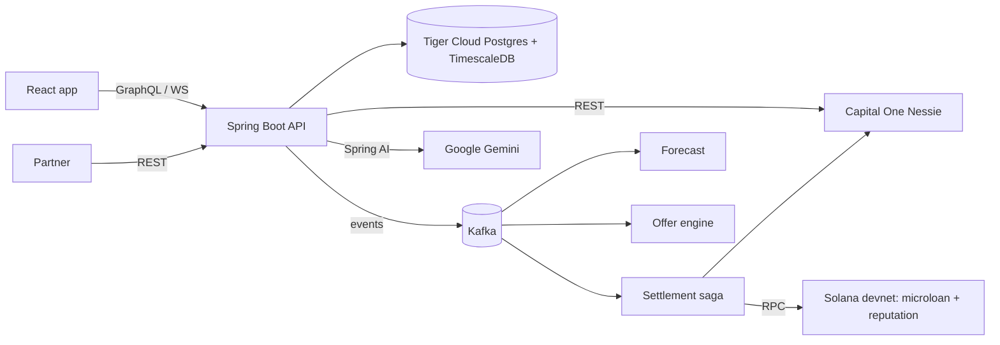

# Weenie Beanie

Proactive micro-loans with an on-chain repayment reputation. Built for a hackathon on Capital One's Nessie sandbox and Solana devnet.

Most banks lend after a customer is already short. Weenie Beanie forecasts the next 12 months of cash flow and spots a shortfall before it happens. It then offers a right-sized, interest-free micro-loan and repays it automatically in the first month that can afford it. Each on-time repayment grows the customer's **beanstalk**: a soulbound credential on Solana that unlocks higher limits. Partners can verify it without seeing any personal data.

> Sandbox only: Nessie test banking data and Solana devnet. No real money moves.

## Features

- **12-month cash-flow forecast.** Built from synced bank history, detected income and bill patterns, and the user's own recurring expenses, e.g. "Netflix for 12 months". Deterministic and explainable.
- **Proactive offers.**
  - Each loan is sized to the projected shortfall, with a flat fee and no interest.
  - It needs explicit consent.
  - Repayment is skipped if it would push the balance below a safety buffer.
- **Purchase check.** Asks "can I afford this?" and, if the gap is repayable, offers a purchase loan. The loan settles straight to the vendor on Solana (Bean Mart demo store).
- **Settlement saga.** The Solana escrow and the Nessie deposit or withdrawal move in step. Each step is idempotent and recorded, so a crash never pays twice.
- **Repayment reputation.**
  - An Anchor reputation account is kept per wallet.
  - A Token-2022 non-transferable credential is minted on the first on-time repayment.
  - Tiers raise the credit limit.
  - Partners verify through a public endpoint that returns no personal data.
- **AI explanations.** Gemini only parses free text and writes plain-language summaries; it never makes credit decisions. Template fallbacks are used when it's unavailable.
- **Live UX.**
  - GraphQL subscriptions over WebSocket.
  - A notification bell and toasts.
  - Presenter tools: advance the month, reset the demo.

## Architecture



| Layer | Stack |
|---|---|
| Backend | Java 21, Spring Boot 3.5, Spring for GraphQL, Spring AI (Gemini), Flyway, solanaj |
| Messaging | Kafka (KRaft) with retry topics and dead-letter topics |
| Database | PostgreSQL / TimescaleDB on Tiger Cloud (hypertables + continuous aggregates) |
| Frontend | React 19, Vite, TypeScript, Apollo Client, Recharts |
| On-chain | Rust / Anchor 1.2.1 programs `microloan` and `reputation`, plus a mock USDC SPL mint |

## Repository layout

```
backend/    Spring Boot modular monolith (auth, cashflow, forecast, ai, loan, settlement, solana, credential, notification, demo, ...)
frontend/   React + Vite app
solana/     Anchor workspace (programs/microloan, programs/reputation), devnet deploy script
infra/      docker-compose for Kafka + Kafka UI
DEMO.md     Presenter walkthrough and troubleshooting
DESIGN.md   Design system
PRODUCT.md  Product brief
audit.md    Architecture decisions, phase plan, progress log
```

## Getting started

### Prerequisites

- JDK 21+, Maven 3.9+
- Node 20+
- Docker (for Kafka)
- A Tiger Cloud (or any PostgreSQL 16 + TimescaleDB) database
- A Capital One Nessie API key
- Optional: Gemini API key; Solana CLI + Anchor 1.2.1 (only to rebuild or redeploy the programs)

### 1. Configure

```bash
cp .env.example .env   # fill in DB, Nessie, JWT, demo user and wallet key
```

Generate the secrets with `openssl rand -base64 32`. The backend reads `.env` from the repo root. The deployed devnet program IDs and the mint are the defaults; see [solana/devnet.env](solana/devnet.env).

To settle on devnet, the bank authority keypair must exist at `~/.config/solana/shbean-bank.json` and be funded with devnet SOL. You can point `SOLANA_BANK_KEYPAIR` at a different file.

### 2. Run

```bash
docker compose -f infra/docker-compose.yml up -d                                # Kafka :9092, Kafka UI :8081
mvn -f backend/pom.xml spring-boot:run -Dspring-boot.run.profiles=dev           # API :8090, Flyway migrates on start
cd frontend && npm install && npm run dev                                       # http://localhost:5173
```

The `dev` profile seeds the demo customer ("Alex"): Nessie history, a projected shortfall, and two prior on-time repayments (Tier 1). Sign in with `DEMO_USER_EMAIL` / `DEMO_USER_PASSWORD`, then follow [DEMO.md](DEMO.md).

### 3. Test

```bash
mvn -f backend/pom.xml test                    # unit + integration tests (Testcontainers: needs Docker)
SHBEAN_SOLANA_LIVE=true mvn -f backend/pom.xml test -Dtest=SettlementDevnetLiveTest   # opt-in, spends devnet SOL
cd frontend && npm run build                   # type-check + production build
```

## Key endpoints

| Endpoint | Purpose |
|---|---|
| `POST /auth/login` | Email/password, returns a JWT |
| `POST /graphql` | App API (forecast, offers, loans, credential, notifications, demo) |
| `WS /graphql-ws` | Subscriptions; JWT sent in `connection_init` |
| `GET /api/public/credentials/{wallet}` | Public reputation verification (no personal data) |

## Deployment

The frontend deploys to Vercel ([frontend/vercel.json](frontend/vercel.json)). Set `VITE_API_BASE_URL` and, optionally, `VITE_WS_URL` to the hosted backend; see [frontend/.env.example](frontend/.env.example).

## Design principles

- Underwriting is rule-based and deterministic; AI never decides credit.
- Nessie owns fiat, Postgres owns derived and loan state, and Solana owns escrow and reputation.
- No personal data is sent to the AI or exposed on-chain. Custodial devnet keys are AES-GCM encrypted at rest.

See [audit.md](audit.md) for the full decision log.
