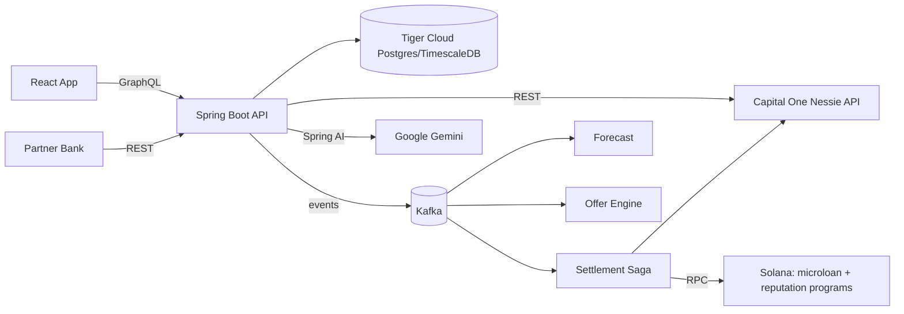

# Project Audit: Proactive Micro-Loans + On-Chain Repayment Reputation

> Single source of context for humans and AI agents. Read this first, then update the **Progress Log** and **Status** sections whenever work is completed.

Last updated: 2026-10-16

---

## 1. Purpose

A hackathon MVP for a banking institution that shifts lending from **reactive** to **proactive**:

1. When a user wants to make a purchase that they can only partially pay, we have an AI agent investigate whether we can give them a micro-loan that they have a high chance of paying off in the next coming months.
2. The AI agent investigates by forecasting the users cash flow in the coming months based on all their banking information (historical data and user-entered recurring expenses and deposits with durations, e.g. "Netflix for 12 months", "car loan for 36 months").
3. If the user accepts the micro-loan, a **Solana powered transaction** instantly transfers the money from the bank to the vendor.
4. **Optional feature:** each on-time repayment updates an on-chain s**Soulbound token**. Higher reputation tiers unlock larger credit limits, and partners can verify the credential via a public endpoint (no PII).

---

## 2. Tech Stack

| Layer | Choice | Notes |
|---|---|---|
| Backend | Java 21, Spring Boot 3.5.x, Maven | Modular monolith (package per domain) |
| API (app) | Spring for GraphQL | Queries, mutations, later subscriptions |
| API (integrations) | REST | Login, webhooks, admin, public credential verify |
| Messaging | **Kafka only** (RabbitMQ rejected) | Event backbone + audit trail; `@RetryableTopic` + DLT for retries |
| Database | PostgreSQL on **Tiger Cloud** (TimescaleDB) | Managed via Tiger CLI + Tiger MCP; hypertables + continuous aggregates |
| Core banking | **Capital One Nessie API** | Source of truth for fiat accounts, balances, transactions |
| AI | **Google GenAI (Gemini)** via Spring AI | Parsing + explanations only, never credit decisions |
| Frontend | React + Vite + TypeScript + Apollo Client | react-router; Recharts planned for forecast chart |
| Blockchain | Solana devnet, Rust/Anchor 0.31.x programs | Java backend calls Solana via solanaj/sava client |
| Local infra | Docker Compose | Kafka (KRaft) + Kafka UI only; DB is Tiger Cloud |

---

## 3. Architecture



### Responsibility split
- **Nessie** owns fiat: balances, deposits, withdrawals, purchases, bills.
- **Postgres** owns derived data (synced transactions, forecasts, offers) and loan state.
- **Solana** owns loan escrow and repayment reputation.

---

## 4. Key Decisions (do not change without updating this file)

1. **Kafka only.** Retries via retry topics + DLT. Idempotent consumers keyed by `eventId`.
2. **Modular monolith.** Packages: `auth`, `user`, `nessie`, `cashflow`, `forecast`, `ai`, `offer`, `loan`, `settlement`, `solana`, `credential`, `notification`, `demo`, `events`.
3. **Deterministic, rule-based underwriting.** AI (Gemini) only parses user input, categorizes merchants, and writes explanations. Required for explainability / fair lending.
4. **Custodial devnet wallets** per user; keys AES-GCM encrypted in Postgres; master key from env.
5. **Mock USDC** SPL mint (6 decimals) controlled by the bank authority.
6. **Auto-repay** via SPL `approve` delegate to the loan PDA at acceptance; the bank authority cranks `repay`.
7. **Simulated clock** (`DemoClock`) drives months; on-chain timing is enforced by the bank authority, not the chain clock.
8. **Credential** = Anchor reputation PDA per wallet + Token-2022 `NonTransferable` token.
9. **Nessie is polled** (no webhooks); dedupe by Nessie `_id`.
10. **Recurring expenses with `durationMonths` live locally**; mirrored to Nessie as bills.
11. **TimescaleDB:** hypertables for `account_transaction`, `balance_snapshot`, `audit_event`; continuous aggregate `monthly_cashflow`. Hypertable unique keys must include the time column. CAGG migrations must run non-transactionally in Flyway, **or** be created `WITH NO DATA` (what V3 does) and refreshed from code via `refresh_continuous_aggregate` outside a transaction.

### Out of scope
Real KYC, real fiat on/off-ramps, mainnet, zero-knowledge proofs, partner-bank integration beyond the public verify endpoint.

---

## 5. Implementation Plan (phases build on each other)

| # | Phase | Depends on | Summary |
|---|---|---|---|
| 0 | Foundations | — | Scaffolding, Kafka compose, Tiger DB + Flyway V1, JWT auth, GraphQL `me`, NessieClient + smoke test, React login shell, Anchor workspace |
| 1 | Nessie ingestion + time-series store | 0 | `DemoSeeder` creates Nessie data ("Alex": shortfall month 4, surplus month 6); `NessieSyncService` polls; hypertables + `monthly_cashflow` CAGG |
| 2 | Forecast engine + dashboard | 1 | `ForecastService` (income patterns + CAGG discretionary avg + recurring expenses, from live Nessie balance); 12-month chart with red/green months |
| 3 | AI layer (Gemini) | 2 | NL expense parsing → user-confirmed drafts; merchant categorization; forecast/offer explanations; cache + fallback; no PII to AI |
| 4 | Kafka backbone | 1 (parallel w/ 2–3) | Event envelope, topics, consumers, audit consumer, idempotency |
| 5 | Offer engine + loan lifecycle | 3, 4 | Shortfall/surplus rules, tier caps, state machine, consent, safeguards using live Nessie balance, `advanceMonth` |
| 6 | Solana programs | parallel w/ 1–5 | Mock USDC, `microloan` + `reputation` programs, Token-2022 SBT, anchor tests, devnet deploy, early Java→Anchor PoC |
| 7 | Settlement saga (Solana + Nessie) | 5, 6 | Disbursement: on-chain disburse → Nessie deposit; Repayment: safeguard → Nessie withdrawal → on-chain repay; compensation on failure |
| 8 | Reputation credential | 7 | Update PDA on repay, mint SBT on first repay, tiers feed offer caps, public REST verify, UI card |
| 9 | Real-time UX + demo polish | 8 | GraphQL subscriptions from Kafka, notifications, demo panel, seeded scenario, demo script |

### Phase details

**Phase 0 — Foundations**
- Tiger CLI: `tiger auth login`, create dev service, `tiger db uri`, `tiger mcp install` (vscode).
- Compose: Kafka KRaft + Kafka UI.
- Backend: Spring Boot, secrets from env/`.env`, Flyway V1 `app_user`, JWT HS256 + `POST /auth/login`, dev-profile demo user seeder, GraphQL `me`, `NessieClient` (customers, accounts), `smoke` profile runner.
- Frontend: Vite React TS, Apollo with auth link, Login + Me pages, Vite proxy.
- Solana: Anchor workspace with stub programs.

**Phase 1 — Nessie ingestion + time-series**
- Hypertables: `account_transaction` (PK `(id, occurred_at)`), `balance_snapshot`, `audit_event`. Regular tables: `recurring_expense`, `loan`, `loan_offer`, `wallet`, `credential`, `forecast_snapshot`.
- Continuous aggregate `monthly_cashflow` (income, spend by category, net per user per month).
- Use `JdbcTemplate` batch inserts for hypertables.

**Phase 2 — Forecast**
- GraphQL: `forecast(months)`, `transactions(range)`, `recurringExpenses`; CRUD mutations for recurring expenses.
- Tests: expenses ending mid-horizon, biweekly income, empty history.
- **Implemented rules (`forecast.ForecastEngine`, pure/deterministic):** history = last 24 complete months, grouped by `kind:merchantId` (or normalized description). Per group: ANNUAL if ≥2 occurrences and all gaps 330–400 days; WEEKLY / BIWEEKLY if ≥3 occurrences and recent gaps 6–8 / 13–15 days (stepped by date); MONTHLY if present in ≥4 of the last 6 months and in one of the last 2 (amount = median monthly sum); stopped monthly series are recognized but not projected. Everything else = "everyday spending" = median over the last 6 months of (CAGG monthly net − patterned items). User recurring expenses apply in their active months and replace a detected outflow in the same category within ±10%. Month 1 = month after the current month (rest of current month not modeled). `shortfall` = projected ending balance < 0. Starting balance = latest `balance_snapshot`.

**Phase 3 — AI (Gemini via Spring AI)**
- Structured output for expense parsing; explanations cached per forecast version; deterministic fallback text.
- **Implemented (`ai` package):** `AiGateway` (only path to Gemini; 15 s timeout, 60 s cooldown after any failure, prompts never logged, disabled when no `ChatModel` bean). `ExpenseParser` (≤500 chars, redacts e-mails/long digit runs, structured output → sanitized drafts; rule-based fallback; drafts are never saved — user confirms via `createRecurringExpense`). `MerchantCategorizer` (Nessie category if canonical → `merchant_category` cache → keyword rules → Gemini; only canonical answers accepted/cached). `ExplanationService` (forecast + offer; sends only months, amounts, categories and pattern types — no descriptions/names/IDs; cached in `ai_explanation` by SHA-256 of kind+model+facts; template fallback is not cached). Canonical categories live in `ai.Categories`.

**Phase 4 — Kafka**
- Envelope: `eventId`, `type`, `userId`, `occurredAt`, `payload`, `correlationId`.
- Topics: `transactions.ingested`, `cashflow.changed`, `forecast.updated`, `offer.generated`, `loan.accepted`, `loan.disbursement.requested`, `loan.disbursed`, `loan.repayment.requested`, `loan.repaid`, `loan.defaulted`, `loan.fiat.settled`, `loan.fiat.failed`, `credential.update.requested`, `credential.updated` (+ retry/DLT).
- **Implemented (`events` package):** `EventEnvelope` (JSON string value, key = userId → per-user ordering), `Topics` (all 14 declared via `KafkaAdmin.NewTopics`, 3 partitions, RF 1), `EventPublisher` (fire-and-forget, `max.block.ms` 5 s; `publish(type, userId, payload, cause)` propagates `correlationId`), `IdempotencyGuard` (`processed_event (consumer, event_id)` marker committed in the same transaction as the handler's DB writes; publish happens after commit), `AuditConsumer` (group `shbean-audit`, all topics → `audit_event` with `id = eventId`, payload `{correlationId, data}`), `DeadLetters` (DLT → `audit_event` type `EVENT_DEAD_LETTERED`). Domain consumers use `@RetryableTopic` (4 attempts, 2 s, single `<topic>.retry` + `<topic>.dlt`); **only one retryable consumer per topic** (shared retry-topic names would cross-deliver between groups). Payloads in `Events` (no PII/Nessie ids).
- **Flow now live:** `NessieSyncService` → `transactions.ingested` (only when rows were inserted) → `CashflowEventsConsumer` → `cashflow.changed` (also published by recurring-expense create/update/delete and by the dev seeder on startup) → `ForecastEventsConsumer` → `forecast_snapshot` (skipped if identical to latest) → `forecast.updated {snapshotId, shortfallMonths, lowestBalance}` — the Phase 5 offer engine consumes this.

**Phase 5 — Offers + lifecycle**
- Rule: shortfall month *m* with deficit *D*; first surplus month *n* (m+1..m+3) with surplus ≥ D + fee; principal = min(ceil(D), tier cap); flat % fee.
- States: `OFFERED → ACCEPTED → DISBURSING → ACTIVE → REPAYING → REPAID` (+ `LATE → DEFAULTED`).
- Safeguards: min-balance check before auto-repay, grace period, reschedule, early repay.
- **Decision (2026-10-17): offer only if the tier cap covers the full deficit** (principal = ceil(D); no partial loans). Caps stay Tier 0 $200 / Tier 1 $500 / Tier 2 $1,000 (`app.loans.tier-caps`). Consequence: the demo user (deficit ≈ $342) gets **no offer at Tier 0** (`creditProfile.offerStatus = EXCEEDS_TIER_CAP`) until Phase 8 raises the tier.
- **Implemented rule (`loan.OfferEngine`, pure):** m = first projected shortfall month; D = ceil(−endingBalanceₘ); fee = 5% of principal (`app.loans.fee-rate`); n = first month in m+1..m+3 with netₙ ≥ D + fee **and** endingBalanceₙ − fee ≥ 0. Reasons when no offer: `NO_SHORTFALL`, `EXCEEDS_TIER_CAP`, `NO_REPAYMENT_MONTH`.
- **Lifecycle (`loan.Loan`, guarded transitions, `@Version`):** `ACCEPTED → DISBURSING → ACTIVE → REPAYING → REPAID`, `REPAYING → LATE → REPAYING (retry) | DEFAULTED`. Offers: `OFFERED → ACCEPTED | DECLINED | SUPERSEDED | EXPIRED`; one open offer and one open loan per user (partial unique indexes). Accept requires `consent = true` and a linked account.
- **Month steps (`LoanService`):** `closeMonth(C)` starts repayments due in C (and retries LATE); LATE past `grace_until_month` (first failure + 1 month) → DEFAULTED. `openMonth(M)` starts disbursements whose shortfall month is M. Accepting an offer whose shortfall month is the current month disburses immediately.
- **Settlement (`LoanSettlementConsumer`, fiat-only until Phase 7):** `loan.disbursement.requested` → Nessie deposit (1st of month) → ACTIVE → `loan.fiat.settled` + `loan.disbursed`. `loan.repayment.requested` → safeguard (effective balance − due ≥ $25, `app.loans.min-buffer-after-repay`) → Nessie withdrawal (last day of month) → REPAID → `loan.fiat.settled` + `loan.repaid`; else LATE + `loan.fiat.failed {INSUFFICIENT_FUNDS}`. Each step re-syncs the user afterwards.
- **Reschedule:** once, before repayment starts, repay month +1, must stay ≤ shortfall + 3. **Early repay:** ACTIVE only; repays in the current month (safeguard applies).
- **Forecast integration:** open loans add `LOAN` lines (disbursement if not yet disbursed and in the future; repayment in repay month, or next month if LATE).
- **DemoClock / `advanceMonth` (dev only, `app.demo.clock-enabled`):** current month = real UTC month + `demo_clock.month_offset`. Advance = post the persona's transactions for the closing month to Nessie (`DemoScenario.simulatedMonth`, relative to `demo_clock.scenario_anchor`) → sync → `closeMonth` → clock +1 → `openMonth` → `cashflow.changed` (reason CLOCK) for every linked user. Forecast, offers, loans and expense drafts all read the month from `DemoClock`.

**Phase 6 — Solana programs**
- `microloan`: `init_pool`, `create_loan`, `disburse`, `repay`, `mark_default`.
- `reputation`: `init_reputation`, `record_repayment`, `record_default` (bank-authority only).
- Token-2022 NonTransferable + metadata SBT.

**Phase 7 — Settlement**
- `SolanaClient` (Anchor 8-byte discriminator + Borsh encoding), `WalletService`, `DisbursementSaga`, `RepaymentSaga`.
- Store Solana tx signature and Nessie transaction id on each loan; UI shows Explorer links.

**Phase 8 — Credential**
- Tiers: Tier 0 $200 → Tier 1 $500 (2 on-time) → Tier 2 $1,000 (5 on-time).
- `GET /api/public/credentials/{wallet}` reads on-chain PDA, returns no PII.

**Phase 9 — Demo polish**
- Subscriptions: `loanUpdated`, `offerCreated`, `credentialUpdated`, `balanceUpdated`.
- Demo script: onboard → forecast dip → offer + AI explanation → accept → disbursement (Solana + Nessie) → advance month → auto-repay → SBT minted / tier up.

---

## 6. Repository Layout

```
sh_bean/
├── audit.md                  # this file
├── .env.example              # copy to .env (git-ignored)
├── .gitignore
├── infra/docker-compose.yml  # Kafka (9092) + Kafka UI (8081)
├── backend/                  # Spring Boot (package com.shbean)
│   ├── pom.xml
│   └── src/
│       ├── main/java/com/shbean/
│       │   ├── ShBeanApplication.java
│       │   ├── auth/         # SecurityConfig, JwtProperties, TokenService, AuthController, AppUserDetailsService
│       │   ├── user/         # AppUser, AppUserRepository, MeController, DemoProperties, DemoUserSeeder
│       │   └── nessie/       # NessieClient, NessieModels, NessieProperties, NessieException, NessieSmokeRunner
│       │   ├── cashflow/     # NessieSyncService, NessieSyncScheduler, SyncController, TransactionStore (JDBC)
│       │   └── demo/         # DemoScenario ("Alex" history), DemoNessieSeeder (dev)
│       ├── main/resources/
│       │   ├── application.yml, application-dev.yml
│       │   ├── db/migration/V1__app_user.sql, V2__core_tables.sql, V3__monthly_cashflow.sql
│       │   └── graphql/schema.graphqls
│       └── test/java/com/shbean/
│           ├── auth/AuthFlowIntegrationTest.java   # Testcontainers (timescale/timescaledb)
│           └── nessie/NessieClientTest.java        # MockRestServiceServer
├── frontend/                 # React + Vite + Apollo
│   ├── package.json, tsconfig.json, vite.config.ts, index.html
│   └── src/ (main.tsx, apollo.ts, auth.ts, index.css, pages/Login.tsx, pages/Me.tsx)
└── solana/                   # Anchor workspace
    ├── Anchor.toml, Cargo.toml
    └── programs/{microloan,reputation}/src/lib.rs   # stubs
```

---

## 7. Configuration & Secrets

All secrets come from environment variables or a root `.env` (imported by Spring via `spring.config.import`). Never commit `.env`.

| Variable | Purpose |
|---|---|
| `DB_URL` | JDBC URL, e.g. `jdbc:postgresql://<host>:<port>/tsdb?sslmode=require` (convert from `tiger db uri`) |
| `DB_USER`, `DB_PASSWORD` | Tiger Cloud credentials |
| `KAFKA_BOOTSTRAP` | Default `localhost:9092` |
| `NESSIE_BASE_URL`, `NESSIE_API_KEY` | Nessie API |
| `GEMINI_API_KEY` | Google GenAI (Phase 3) |
| `GEMINI_MODEL` | Default `gemini-2.5-flash` (thinking budget 0, temperature 0.2) |
| `AI_CHAT_MODEL` | Default `google-genai`; set `none` to run without Gemini (fallbacks only; tests do this) |
| `JWT_SECRET` | ≥ 32 bytes (`openssl rand -base64 48`); app refuses to start otherwise |
| `DEMO_USER_EMAIL`, `DEMO_USER_PASSWORD` | Seeded in `dev` profile |
| `SERVER_PORT` | Backend port, default **8090** (8080 is taken by local Jenkins) |

Other properties: `nessie.sync.enabled` (default true), `nessie.sync.interval` (default `PT15M`), `nessie.sync.initial-delay` (default `PT1M`), `app.demo.seed-nessie` (default true).

Spring profiles: `dev` (GraphiQL, demo user seeding, Nessie "Alex" scenario seeding + initial sync), `smoke` (Nessie round-trip on startup).

---

## 8. Security Conventions

- Stateless JWT (HS256) on all routes except `POST /auth/login`, `/actuator/health`, `/graphiql/**`, `/error`.
- Passwords hashed with BCrypt; generic "Invalid credentials" on any login failure.
- **Nessie API key travels as a query param.** `NessieClient` wraps all calls and throws `NessieException` **without chaining the cause** (RestClient messages contain the full URI); the root-cause message is included only after redacting the key. Never log Nessie request URLs. Tests assert the key never appears in exceptions.
- GraphQL exposes a `UserView` record, never the entity (no password hash leakage).
- Frontend stores the token in `sessionStorage`; 401 → clear token and redirect to login.
- AI receives only aggregated figures — no Nessie IDs, account numbers, or names.
- Public credential endpoint must return no PII.
- Wallet private keys encrypted at rest; never logged.

---

## 9. Status

| Phase | Status |
|---|---|
| 0 Foundations | **Verified** except frontend login check and `anchor build` (Anchor CLI not installed) |
| 1 Nessie ingestion + time-series | **Done & verified on Tiger** (V2/V3 applied, 364 demo txns seeded + synced, dedupe + CAGG verified) |
| 2 Forecast engine + dashboard | **Done & verified on Tiger data** (demo forecast: shortfall Feb–Mar 2027 = months +4/+5, surplus Apr 2027 = month +6). Dashboard UI built; visual check pending |
| 3 AI layer (Gemini) | **Done & verified live** (explanation 1.5 s uncached / 0.3 s cached; NL drafts correct incl. "3 more years" → 36, "starting January" → 2027-01) |
| 4 Kafka backbone | **Done & verified** (Testcontainers Kafka chain test + dev: topics/groups created, startup chain produced forecast snapshot + audited events) |
| 5 Offer engine + loan lifecycle | **Done & verified** (unit + Kafka lifecycle integration tests; dev: V6 applied, demo user correctly gets `EXCEEDS_TIER_CAP` at Tier 0). `advanceMonth` not yet exercised against live Nessie |
| 6 – 9 | Not started |

### Phase 0 verification checklist
- [x] User: `tiger auth login`, create service, `tiger mcp install`; fill `.env`
- [x] User: obtain Nessie and Gemini API keys
- [x] `docker compose -f infra/docker-compose.yml up -d` → Kafka healthy, Kafka UI at http://localhost:8081
- [x] `cd backend && mvn verify` (unit + Testcontainers tests; needs Docker)
- [x] `mvn spring-boot:run -Dspring-boot.run.profiles=dev` → Flyway V1 applied on Tiger, demo user seeded
- [x] `mvn spring-boot:run -Dspring-boot.run.profiles=smoke` → Nessie customer + account created and read back; key not in logs
- [ ] `cd frontend && npm install && npm run dev` → login at http://localhost:5173, Me page shows email
- [ ] `cd solana && anchor build && anchor keys sync` → real program IDs replace placeholders

---

## 10. Progress Log

| Date | Change |
|---|---|
| 2026-10-16 | Idea selected (proactive micro-loans + hybrid reputation credential). Stack decided: Spring Boot, GraphQL + REST, Kafka (RabbitMQ rejected). |
| 2026-10-16 | Plan v2: switched MySQL → Postgres/TimescaleDB on Tiger Cloud; added Capital One Nessie as core banking. |
| 2026-10-16 | Phase 0 scaffolding written in `sh_bean/` (backend, frontend, infra, solana stubs). Not yet built or run. |
| 2026-10-16 | `mvn verify` green (6/6). Fixed `AuthFlowIntegrationTest`: Spring GraphQL may complete `/graphql` synchronously, so the test handles both sync and async responses. |
| 2026-10-16 | Dev run verified on Tiger service `sh_bean` (`xubqw8c48z`): V1 applied, demo login + GraphQL `me` OK. Added Flyway `baseline-on-migrate` (version 0) because Tiger pre-populates `public`. `.env` `DB_URL` must be JDBC form with separate `DB_USER`. |
| 2026-10-17 | Nessie smoke verified (customer + account round-trip, key absent from logs). Switched Nessie to HTTPS. `NessieClient` errors now include the root cause with the API key redacted. |
| 2026-10-17 | Backend port moved to **8090** (`SERVER_PORT`, default 8090) because local Jenkins occupies 8080; Vite proxy updated. |
| 2026-10-17 | **Phase 1 done.** V2 (hypertables `account_transaction`, `balance_snapshot`, `audit_event` + regular tables `recurring_expense`, `forecast_snapshot`, `loan_offer`, `loan`, `wallet`, `credential`), V3 (`monthly_cashflow` CAGG per user/month/category, `WITH NO DATA` + hourly policy, real-time enabled). `NessieClient` gained deposits/withdrawals/purchases/merchants. `cashflow.NessieSyncService` (poll every 15 min + GraphQL `syncTransactions` mutation; JDBC batch insert `ON CONFLICT DO NOTHING`; refreshes CAGG for touched months; balance snapshot + audit event per sync). `demo.DemoScenario` (20 months, deterministic) + `demo.DemoNessieSeeder` (dev profile, 8-way parallel posting, links user only after full seed). Tests: 12/12 green. On Tiger: 364 txns seeded, re-sync inserted 0; CAGG shows insurance months 2025-02/2026-02 (net ≈ −1,100) and bonus months 2025-04/2026-04 (net ≈ +1,400); steady months ≈ +70..+200. |
| 2026-10-17 | **Phase 2 done.** Effective balance decision implemented: first sync anchors to Nessie's balance; each later sync stores `latest snapshot + sum(newly inserted transactions)` (`TransactionStore.insertNew` returns the inserted rows). New: `forecast.ForecastEngine` / `ForecastService` / `ForecastController`; `cashflow.RecurringExpense` (JPA) + `RecurringExpenseService` (validation, owner-scoped update/delete, mirrored to Nessie bills best-effort) + `CashflowController` (`transactions`, `recurringExpenses`, create/update/delete mutations); `GraphQlValidationErrors` maps `IllegalArgumentException` → BAD_REQUEST. `NessieClient` gained create/update/delete bill (verified live: PUT 202, DELETE 200). Frontend: `pages/Dashboard.tsx` at `/` (Recharts red/green ending-balance bars, month table + line breakdown, recurring-expense list/add/remove, Sync button); profile moved to `/me`. Tests: 20/20 green. Live forecast for demo user: +$152/month steady, Feb 2027 −$342 (shortfall), Mar 2027 −$190 (shortfall), Apr 2027 +$1,352 net. |
| 2026-10-17 | **Phase 3 done.** Spring AI **1.1.8** BOM + `spring-ai-starter-model-google-genai` (1.1.x is the Boot 3.5 line; 2.x needs Boot 4). V4: `ai_explanation`, `merchant_category` cache tables. New `ai` package: `AiGateway`, `Categories`, `AiCache`, `ExpenseParser`, `MerchantCategorizer`, `ExplanationService`, `AiController`. GraphQL: `Forecast.explanation { text source }`, `draftRecurringExpenses(text)` mutation, `categories` query, `AiSource` enum. `NessieSyncService` now categorizes merchants via `MerchantCategorizer` (Uncategorized results are not memoized, so they retry). `ExplanationService.explainOffer(OfferFacts)` is ready for Phase 5. Frontend: AI summary card, "Describe your recurring expenses" assistant with Add/Discard per draft, category dropdown. Tests: 31/31 green (unit tests mock `AiGateway`; integration tests run with `spring.ai.model.chat=none`). |
| 2026-10-17 | **Phase 4 done.** V5 `processed_event`. New `events` package (`EventEnvelope`, `Topics`, `Events`, `EventPublisher`, `IdempotencyGuard`, `AuditConsumer`, `DeadLetters`), `cashflow.CashflowEventsConsumer`, `forecast.ForecastEventsConsumer` + `ForecastSnapshotStore`. Removed the direct `NESSIE_SYNCED` audit write (audit trail is now event-driven). Kafka producer `acks=all`, idempotent, `max.block.ms=5000`; consumers `auto-offset-reset=earliest`. Tests: shared `TestInfra` (TimescaleDB + `apache/kafka:3.9.1` via `@ServiceConnection`), new chain/correlation and idempotency-rollback tests; 32/32 green. Dev on Tiger: V5 applied; topics + `.retry`/`.dlt` created; groups `shbean-audit`, `shbean-cashflow`, `shbean-forecast` (+ retry/dlt); startup produced `cashflow.changed` → snapshot → `forecast.updated`, both audited. |
| 2026-10-17 | **Phase 5 done.** V6: `demo_clock` (offset + scenario anchor), `loan_offer` (+deficit, projected_surplus, tier, decided_at, one-open-offer index), `loan` (+grace_until_month, reschedule_count, repaid_at, last_failure, one-open-loan index). New `loan` package: `LoanProperties`, `OfferEngine`, `LoanOffer`/`Loan` (JPA), repositories, `CreditTiers` (reads `credential.tier`, default 0), `OfferService` + `OfferEventsConsumer` (`forecast.updated` → `offer.generated`; AI explanation generated outside the DB transaction; unchanged terms keep the existing offer, otherwise SUPERSEDED/EXPIRED), `LoanService`, `LoanSettlementConsumer`, `LoanController`. New `demo`: `DemoClock`, `DemoPoster` (shared with seeder; looks up merchants via new `NessieClient.listMerchants`), `DemoService` (advanceMonth); `DemoScenario.simulatedMonth`. `ForecastEngine` gained `OneOff` flows + `Source.LOAN`; `ForecastService`/`AiController` use `DemoClock`. GraphQL: `currentOffer`, `loans`, `creditProfile`, `demoClock`, `acceptOffer(offerId, consent)`, `declineOffer`, `rescheduleLoan`, `repayLoanEarly`, `advanceMonth`. Frontend: `components/LoansPanel.tsx` (offer card with consent checkbox, loan table with reschedule/repay-now, credit tier line, demo clock + "Advance one month"; polls every 3 s). Tests: 44/44 green (new `OfferEngineTest`, `LoanTest`, `LoanLifecycleIntegrationTest` incl. LATE → DEFAULTED). |

---

## 11. Known Issues / Open Questions

- **Nessie base URL is now `https://api.nessieisreal.com`** (plain HTTP is unreachable). Verified via smoke profile.
- **Nessie does not update account balances** when deposits/withdrawals/purchases post, and it **truncates amounts to whole dollars**. The demo account is created with its *current* balance ($300). **Decision (2026-10-17):** effective balance = last recorded `balance_snapshot` + everything that posted since; Nessie's balance is read only once, to anchor the first snapshot. Phases 5/7 (safeguards, settlement) must use `TransactionStore.latestBalance`, never Nessie's account balance.
- Balance carry-forward relies on per-row batch update counts; do not enable pgjdbc `reWriteBatchedInserts` (it returns SUCCESS_NO_INFO and newly posted transactions would not be added to the balance).
- Nessie merchant `category` is a string in the live API (arrays rejected on create); the model accepts both.
- Demo scenario months are relative to the month the seeder ran (UTC): history = current−20 .. current−1; shortfall = month +4 (annual insurance), surplus = month +6 (annual bonus). Reseeding requires clearing the user's Nessie link (`nessie_customer_id`, `nessie_checking_account_id`) and their `account_transaction` rows.
- `monthly_cashflow` buckets are UTC; render months in UTC to avoid off-by-one display.
- Frontend login + dashboard have not been visually verified yet (Phase 0 checklist / Phase 2).
- `.env.example` is deleted in the working tree (still in git); restore it so new contributors know which variables to set.
- Frontend bundle is ~865 kB (Recharts); code-split later if needed.
- AI explanations are cached forever per facts hash; the cache key includes the model name, so changing `GEMINI_MODEL` regenerates them. No per-user rate limit on `draftRecurringExpenses` yet (input capped at 500 chars, 60 s cooldown after failures).
- With `AI_CHAT_MODEL=google-genai` and no `GEMINI_API_KEY`, Spring AI may fail at startup; set `AI_CHAT_MODEL=none` in that case.
- Event publishing is best-effort (no transactional outbox): if Kafka is down when a sync inserts rows, `transactions.ingested` is lost and the forecast snapshot is only refreshed on the next change/startup. Acceptable for the MVP; an outbox table would close the gap.
- Kafka must be running for the backend (`docker compose -f infra/docker-compose.yml up -d`); without it, listeners log connection warnings and each publish blocks up to 5 s.
- Settlement calls Nessie inside the idempotency transaction: if Nessie succeeds but the DB commit then fails, the retry would post a second deposit/withdrawal. Rare; Phase 7's saga should record the Nessie id before committing or check Nessie for an existing transfer.
- `advanceMonth` simulates only the demo persona's transactions; user-entered recurring expenses (Nessie bills) are not auto-paid by Nessie, so they affect the forecast but not the simulated balance. Months between the scenario anchor and the real current month are never simulated if the real calendar moves on.
- `advanceMonth` is global (moves the clock for all users) and is exposed to any authenticated user when `app.demo.clock-enabled=true` (dev profile only). Reset with `UPDATE demo_clock SET month_offset = 0` (Nessie transactions already posted stay).
- Nessie endpoint shapes are based on the standard Nessie API (`/customers`, `/customers/{id}/accounts`, `/accounts/{id}`, `?key=`); verify with the smoke profile.
- Anchor programs share a placeholder program ID until `anchor keys sync`.
- Dependency versions were pinned without network verification (Spring Boot 3.5.6, Anchor 0.31.1, Vite 6, React 19, Apollo Client 3.13); bump if newer stable versions are desired.
- Choose solanaj vs sava for the Java Solana client (PoC planned in Phase 6).
- Nessie rate limits / shared sandbox: sync on demand, cache, use WireMock recordings in CI.
- The original workspace folder `sh_planning` was removed; the project lives in `sh_bean`.

---

## 12. Instructions for Agents

1. Read sections 1, 4, 5, and 9 before writing code.
2. Work phase by phase; don't start a phase whose dependencies aren't verified.
3. Respect the Key Decisions and Security Conventions; record any deviation here.
4. After completing work: update **Status**, tick checklist items, and append to the **Progress Log**.
5. New Flyway migrations: increment version (`V2__...`); never edit applied migrations.
6. New Kafka topics: declare as `NewTopic` beans (auto-create is disabled in compose).
