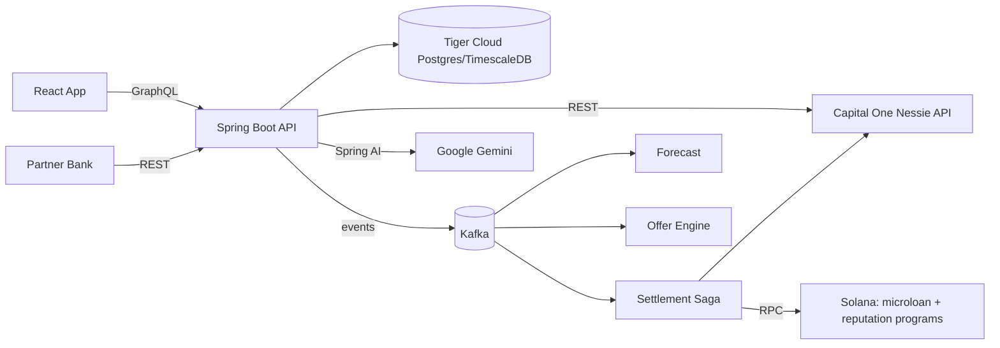

# Project Audit: Proactive Micro-Loans + On-Chain Repayment Reputation

> Single source of context for humans and AI agents. Read this first, then update the **Progress Log** and **Status** sections whenever work is completed.

Last updated: 2026-10-17

---

## 1. Purpose

A hackathon MVP for a banking institution that shifts lending from **reactive** to **proactive**:

1. When a user wants to make a purchase that they can only partially pay, we have an AI agent investigate whether we can give them a micro-loan that they have a high chance of paying off in the next coming months.
2. The AI agent investigates by forecasting the users cash flow in the coming months based on all their banking information (historical data and user-entered recurring expenses and deposits with durations, e.g. "Netflix for 12 months", "car loan for 36 months").
3. If the user accepts the micro-loan, a **Solana powered transaction** instantly transfers the money from the bank to the vendor.
4. **Optional feature:** each on-time repayment updates an on-chain s**Soulbound token**. Higher reputation tiers unlock larger credit limits, and partners can verify the credential via a public endpoint (no PII).

---

## 2. Tech Stack

| Layer | Choice | Notes |
|---|---|---|
| Backend | Java 21, Spring Boot 3.5.x, Maven | Modular monolith (package per domain) |
| API (app) | Spring for GraphQL | Queries, mutations, later subscriptions |
| API (integrations) | REST | Login, webhooks, admin, public credential verify |
| Messaging | **Kafka only** (RabbitMQ rejected) | Event backbone + audit trail; `@RetryableTopic` + DLT for retries |
| Database | PostgreSQL on **Tiger Cloud** (TimescaleDB) | Managed via Tiger CLI + Tiger MCP; hypertables + continuous aggregates |
| Core banking | **Capital One Nessie API** | Source of truth for fiat accounts, balances, transactions |
| AI | **Google GenAI (Gemini)** via Spring AI | Parsing + explanations only, never credit decisions |
| Frontend | React + Vite + TypeScript + Apollo Client | react-router; Recharts planned for forecast chart |
| Blockchain | Solana devnet, Rust/**Anchor 1.2.1** programs (SBPF v2) | Java backend: `AnchorCodec` + **solanaj 1.28.0** (`com.mmorrell:solanaj`) hidden behind the `SolanaClient` interface |
| Local infra | Docker Compose | Kafka (KRaft) + Kafka UI only; DB is Tiger Cloud |

---

## 3. Architecture



### Responsibility split
- **Nessie** owns fiat: balances, deposits, withdrawals, purchases, bills.
- **Postgres** owns derived data (synced transactions, forecasts, offers) and loan state.
- **Solana** owns loan escrow and repayment reputation.

---

## 4. Key Decisions (do not change without updating this file)

1. **Kafka only.** Retries via retry topics + DLT. Idempotent consumers keyed by `eventId`.
2. **Modular monolith.** Packages: `auth`, `user`, `nessie`, `cashflow`, `forecast`, `ai`, `offer`, `loan`, `settlement`, `solana`, `credential`, `notification`, `demo`, `events`.
3. **Deterministic, rule-based underwriting.** AI (Gemini) only parses user input, categorizes merchants, and writes explanations. Required for explainability / fair lending.
4. **Custodial devnet wallets** per user; keys AES-GCM encrypted in Postgres; master key from env.
5. **Mock USDC** SPL mint (6 decimals) controlled by the bank authority.
6. **Auto-repay** via SPL `approve` delegate to the loan PDA at acceptance; the bank authority cranks `repay`.
7. **Simulated clock** (`DemoClock`) drives months; on-chain timing is enforced by the bank authority, not the chain clock.
8. **Credential** = Anchor reputation PDA per wallet + Token-2022 `NonTransferable` token.
9. **Nessie is polled** (no webhooks); dedupe by Nessie `_id`.
10. **Recurring expenses with `durationMonths` live locally**; mirrored to Nessie as bills.
11. **TimescaleDB:** hypertables for `account_transaction`, `balance_snapshot`, `audit_event`; continuous aggregate `monthly_cashflow`. Hypertable unique keys must include the time column. CAGG migrations must run non-transactionally in Flyway, **or** be created `WITH NO DATA` (what V3 does) and refreshed from code via `refresh_continuous_aggregate` outside a transaction.

### Out of scope
Real KYC, real fiat on/off-ramps, mainnet, zero-knowledge proofs, partner-bank integration beyond the public verify endpoint.

---

## 5. Implementation Plan (phases build on each other)

| # | Phase | Depends on | Summary |
|---|---|---|---|
| 0 | Foundations | — | Scaffolding, Kafka compose, Tiger DB + Flyway V1, JWT auth, GraphQL `me`, NessieClient + smoke test, React login shell, Anchor workspace |
| 1 | Nessie ingestion + time-series store | 0 | `DemoSeeder` creates Nessie data ("Alex": shortfall month 4, surplus month 6); `NessieSyncService` polls; hypertables + `monthly_cashflow` CAGG |
| 2 | Forecast engine + dashboard | 1 | `ForecastService` (income patterns + CAGG discretionary avg + recurring expenses, from live Nessie balance); 12-month chart with red/green months |
| 3 | AI layer (Gemini) | 2 | NL expense parsing → user-confirmed drafts; merchant categorization; forecast/offer explanations; cache + fallback; no PII to AI |
| 4 | Kafka backbone | 1 (parallel w/ 2–3) | Event envelope, topics, consumers, audit consumer, idempotency |
| 5 | Offer engine + loan lifecycle | 3, 4 | Shortfall/surplus rules, tier caps, state machine, consent, safeguards using live Nessie balance, `advanceMonth` |
| 6 | Solana programs | parallel w/ 1–5 | Mock USDC, `microloan` + `reputation` programs, Token-2022 SBT, anchor tests, devnet deploy, early Java→Anchor PoC |
| 7 | Settlement saga (Solana + Nessie) | 5, 6 | Disbursement: on-chain disburse → Nessie deposit; Repayment: safeguard → Nessie withdrawal → on-chain repay; compensation on failure |
| 8 | Reputation credential | 7 | Update PDA on repay, mint SBT on first repay, tiers feed offer caps, public REST verify, UI card |
| 9 | Real-time UX + demo polish | 8 | GraphQL subscriptions from Kafka, notifications, demo panel, seeded scenario, demo script |
| 10 | Purchase loan + vendor settlement | 7, 9 | Affordability check (stateless what-if), purchase loans superseding baseline offers, on-chain vendor settlement (SPL transfer), Bean Mart demo store |

### Phase details

**Phase 0 — Foundations**
- Tiger CLI: `tiger auth login`, create dev service, `tiger db uri`, `tiger mcp install` (vscode).
- Compose: Kafka KRaft + Kafka UI.
- Backend: Spring Boot, secrets from env/`.env`, Flyway V1 `app_user`, JWT HS256 + `POST /auth/login`, dev-profile demo user seeder, GraphQL `me`, `NessieClient` (customers, accounts), `smoke` profile runner.
- Frontend: Vite React TS, Apollo with auth link, Login + Me pages, Vite proxy.
- Solana: Anchor workspace with stub programs (replaced by real programs in Phase 6).

**Phase 1 — Nessie ingestion + time-series**
- Hypertables: `account_transaction` (PK `(id, occurred_at)`), `balance_snapshot`, `audit_event`. Regular tables: `recurring_expense`, `loan`, `loan_offer`, `wallet`, `credential`, `forecast_snapshot`.
- Continuous aggregate `monthly_cashflow` (income, spend by category, net per user per month).
- Use `JdbcTemplate` batch inserts for hypertables.

**Phase 2 — Forecast**
- GraphQL: `forecast(months)`, `transactions(range)`, `recurringExpenses`; CRUD mutations for recurring expenses.
- Tests: expenses ending mid-horizon, biweekly income, empty history.
- **Implemented rules (`forecast.ForecastEngine`, pure/deterministic):** history = last 24 complete months, grouped by `kind:merchantId` (or normalized description). Per group: ANNUAL if ≥2 occurrences and all gaps 330–400 days; WEEKLY / BIWEEKLY if ≥3 occurrences and recent gaps 6–8 / 13–15 days (stepped by date); MONTHLY if present in ≥4 of the last 6 months and in one of the last 2 (amount = median monthly sum); stopped monthly series are recognized but not projected. Everything else = "everyday spending" = median over the last 6 months of (CAGG monthly net − patterned items). User recurring expenses apply in their active months and replace a detected outflow in the same category within ±10%. Month 1 = month after the current month (rest of current month not modeled). `shortfall` = projected ending balance < 0. Starting balance = latest `balance_snapshot`.

**Phase 3 — AI (Gemini via Spring AI)**
- Structured output for expense parsing; explanations cached per forecast version; deterministic fallback text.
- **Implemented (`ai` package):** `AiGateway` (only path to Gemini; 15 s timeout, 60 s cooldown after any failure, prompts never logged, disabled when no `ChatModel` bean). `ExpenseParser` (≤500 chars, redacts e-mails/long digit runs, structured output → sanitized drafts; rule-based fallback; drafts are never saved — user confirms via `createRecurringExpense`). `MerchantCategorizer` (Nessie category if canonical → `merchant_category` cache → keyword rules → Gemini; only canonical answers accepted/cached). `ExplanationService` (forecast + offer; sends only months, amounts, categories and pattern types — no descriptions/names/IDs; cached in `ai_explanation` by SHA-256 of kind+model+facts; template fallback is not cached). Canonical categories live in `ai.Categories`.

**Phase 4 — Kafka**
- Envelope: `eventId`, `type`, `userId`, `occurredAt`, `payload`, `correlationId`.
- Topics: `transactions.ingested`, `cashflow.changed`, `forecast.updated`, `offer.generated`, `loan.accepted`, `loan.disbursement.requested`, `loan.disbursed`, `loan.repayment.requested`, `loan.repaid`, `loan.defaulted`, `loan.fiat.settled`, `loan.fiat.failed`, `credential.update.requested`, `credential.updated` (+ retry/DLT).
- **Implemented (`events` package):** `EventEnvelope` (JSON string value, key = userId → per-user ordering), `Topics` (all 14 declared via `KafkaAdmin.NewTopics`, 3 partitions, RF 1), `EventPublisher` (fire-and-forget, `max.block.ms` 5 s; `publish(type, userId, payload, cause)` propagates `correlationId`), `IdempotencyGuard` (`processed_event (consumer, event_id)` marker committed in the same transaction as the handler's DB writes; publish happens after commit), `AuditConsumer` (group `shbean-audit`, all topics → `audit_event` with `id = eventId`, payload `{correlationId, data}`), `DeadLetters` (DLT → `audit_event` type `EVENT_DEAD_LETTERED`). Domain consumers use `@RetryableTopic` (4 attempts, 2 s, single `<topic>.retry` + `<topic>.dlt`); **only one retryable consumer per topic** (shared retry-topic names would cross-deliver between groups). Payloads in `Events` (no PII/Nessie ids).
- **Flow now live:** `NessieSyncService` → `transactions.ingested` (only when rows were inserted) → `CashflowEventsConsumer` → `cashflow.changed` (also published by recurring-expense create/update/delete and by the dev seeder on startup) → `ForecastEventsConsumer` → `forecast_snapshot` (skipped if identical to latest) → `forecast.updated {snapshotId, shortfallMonths, lowestBalance}` — the Phase 5 offer engine consumes this.

**Phase 5 — Offers + lifecycle**
- Rule: shortfall month *m* with deficit *D*; first surplus month *n* (m+1..m+3) with surplus ≥ D + fee; principal = min(ceil(D), tier cap); flat % fee.
- States: `OFFERED → ACCEPTED → DISBURSING → ACTIVE → REPAYING → REPAID` (+ `LATE → DEFAULTED`).
- Safeguards: min-balance check before auto-repay, grace period, reschedule, early repay.
- **Decision (2026-10-17): offer only if the tier cap covers the full deficit** (principal = ceil(D); no partial loans). Caps stay Tier 0 $200 / Tier 1 $500 / Tier 2 $1,000 (`app.loans.tier-caps`). Consequence: the demo user (deficit ≈ $342) gets **no offer at Tier 0** (`creditProfile.offerStatus = EXCEEDS_TIER_CAP`) until Phase 8 raises the tier.
- **Implemented rule (`loan.OfferEngine`, pure):** m = first projected shortfall month; D = ceil(−endingBalanceₘ); fee = 5% of principal (`app.loans.fee-rate`); n = first month in m+1..m+3 with netₙ ≥ D + fee **and** endingBalanceₙ − fee ≥ 0. Reasons when no offer: `NO_SHORTFALL`, `EXCEEDS_TIER_CAP`, `NO_REPAYMENT_MONTH`.
- **Lifecycle (`loan.Loan`, guarded transitions, `@Version`):** `ACCEPTED → DISBURSING → ACTIVE → REPAYING → REPAID`, `REPAYING → LATE → REPAYING (retry) | DEFAULTED`. Offers: `OFFERED → ACCEPTED | DECLINED | SUPERSEDED | EXPIRED`; one open offer and one open loan per user (partial unique indexes). Accept requires `consent = true` and a linked account.
- **Month steps (`LoanService`):** `closeMonth(C)` starts repayments due in C (and retries LATE); LATE past `grace_until_month` (first failure + 1 month) → DEFAULTED. `openMonth(M)` starts disbursements whose shortfall month is M. Accepting an offer whose shortfall month is the current month disburses immediately.
- **Settlement (`LoanSettlementConsumer`, fiat-only until Phase 7; replaced by the `settlement` package):** `loan.disbursement.requested` → Nessie deposit (1st of month) → ACTIVE → `loan.fiat.settled` + `loan.disbursed`. `loan.repayment.requested` → safeguard (effective balance − due ≥ $25, `app.loans.min-buffer-after-repay`) → Nessie withdrawal (last day of month) → REPAID → `loan.fiat.settled` + `loan.repaid`; else LATE + `loan.fiat.failed {INSUFFICIENT_FUNDS}`. Each step re-syncs the user afterwards.
- **Reschedule:** once, before repayment starts, repay month +1, must stay ≤ shortfall + 3. **Early repay:** ACTIVE only; repays in the current month (safeguard applies).
- **Forecast integration:** open loans add `LOAN` lines (disbursement if not yet disbursed and in the future; repayment in repay month, or next month if LATE).
- **DemoClock / `advanceMonth` (dev only, `app.demo.clock-enabled`):** current month = real UTC month + `demo_clock.month_offset`. Advance = post the persona's transactions for the closing month to Nessie (`DemoScenario.simulatedMonth`, relative to `demo_clock.scenario_anchor`) → sync → `closeMonth` → clock +1 → `openMonth` → `cashflow.changed` (reason CLOCK) for every linked user. Forecast, offers, loans and expense drafts all read the month from `DemoClock`.

**Phase 6 — Solana programs**
- `microloan`: `init_pool`, `create_loan`, `disburse`, `repay`, `mark_default`.
- `reputation`: `init_reputation`, `record_repayment`, `record_default` (bank-authority only).
- Token-2022 NonTransferable + metadata SBT.
- **Toolchain (2026-10-17):** Anchor CLI/crates **1.2.1** (user chose to upgrade from 0.31.1), Agave/Solana CLI 4.3.1, platform-tools v1.58, Rust 1.89 (`solana/rust-toolchain.toml`). Build with **`anchor build --arch v2`**: Anchor 1.2 defaults to SBPF v3, but the LiteSVM release compatible with Anchor 1.2.1's Solana 3.x crates (0.10) only runs SBPF ≤ v2 (LiteSVM ≥ 0.13.1 is needed for v3, and 0.14 pulls Agave 4.3 crates that conflict). SBPF v2 deployment is active on devnet. On this Mac, set `SDKROOT=/Library/Developer/CommandLineTools/SDKs/MacOSX26.5.sdk` (the CLT linker cannot read the macOS 27 SDK: `tapi error: malformed file`).
- **Program IDs:** `microloan` = `7RPbrV9Ft664iLK95bYsZbNascy9wwX57Tk6UCAM4uXk`, `reputation` = `HicA6FJxaS4DTqZL5reqxHmYcXyEKBsPkJnguMUPVnsh` (keypairs in git-ignored `solana/target/deploy/` — back them up; losing them means losing upgrade ability).
- **`microloan` design:** `Pool` PDA `["pool", mint]` + vault token PDA `["vault", pool]` (authority = pool). `init_pool` only by the **stablecoin's mint authority** (prevents squatting the deterministic pool PDA). `Loan` PDA `["loan", pool, loan_ref(16-byte backend UUID)]`. `create_loan` is signed by bank **and** borrower; it CPIs SPL `approve` delegating exactly principal + fee to the loan PDA (on-chain auto-repay consent, decision 6). `disburse` (pool PDA signs vault → borrower), `repay` (loan PDA as delegate pulls borrower → vault; borrower does not sign), `mark_default`. Fee ≤ 20% of principal; months are YYYYMM, repay > disburse; timing enforced off-chain (decision 7). Token-interface (works with SPL Token or Token-2022 mints). Events: `LoanCreated/Disbursed/Repaid/Defaulted`.
- **`reputation` design:** `Config` PDA `["config", authority]` (per-bank namespace, no global squatting); `Reputation` PDA `["reputation", config, wallet]` with on-time/late/default counters, `total_repaid`, `tier`, `sbt_mint`. Tier = effective on-time (on_time − 2·defaults) ≥ 5 → 2, ≥ 2 → 1, else 0 (late repayments don't count). `mint_credential(uri)` (requires ≥ 1 on-time, once): creates Token-2022 mint PDA `["sbt", reputation]` with **NonTransferable + MetadataPointer(self)**, TokenMetadata ("ShBean Repayment Credential" / `SHBREP` / uri, update authority = config PDA), mints 1 to the wallet's Token-2022 ATA, then **removes the mint authority** (supply fixed at 1). Anchor 1.2.1 has no `extensions::non_transferable` constraint, so the mint is created/initialized manually.
- **Tests (LiteSVM, `cargo test` in `solana/`):** 7/7 — full loan lifecycle with delegated auto-repay; only mint authority can open the pool; fee/months validation, missing borrower signature, wrong authority, double-disburse, repay-before-disburse, default-then-repay; SBT minted once with correct extensions/metadata/supply and **transfer rejected by Token-2022** ("Transfer is disabled for this mint"); tier progression; another authority cannot write a reputation. Both programs pass the Solana MCP `program_autofixer` with zero issues.
- **Java → Anchor PoC:** `backend/.../solana/AnchorCodec` (discriminators, Borsh args for `create_loan`/`record_repayment`/`mint_credential`, `Loan` account decoder). Golden vector pinned in both Rust (`create_loan_instruction_data_matches_java_golden_vector`) and Java (`AnchorCodecTest`) — byte-identical. PDA golden vectors (pool/vault/loan for the live mint) are pinned the same way (`pda_derivation_golden_vectors` ↔ `SolanajClientTest`). Rust suite is now 8/8.
- **Java Solana client (decision 2026-10-17: solanaj, behind a thin interface):** package `com.shbean.solana`. `SolanaClient` (interface; only base58 strings, `byte[]` and own records — no solanaj types) with `getAccount`, `getBalance`, `findProgramAddress`, `sign`, `submit`, `status`, `isBlockhashValid`, plus defaults `awaitConfirmation` / `sendAndConfirm`. `SolanajClient` is the **only** class importing `org.p2p.solanaj`; swapping libraries later means rewriting one class. Supporting: `Keypair` (JDK Ed25519, 64-byte Solana layout, `toString` shows only the address, `fromJson` for `solana-keygen` files), `Base58`, `SolanaException` (never carries URLs/keys), `SolanaProperties` (`solana.rpc-url` / `SOLANA_RPC_URL`, `commitment`, `confirm-timeout`; `toString` masks the URL because hosted RPC URLs embed API keys).
  - **Sign/submit split on purpose:** the transaction signature is known before sending, so Phase 7 sagas must persist `SignedTransaction.signature` (and `blockhash`) first; after a crash, `status(signature)` tells whether it landed (`NOT_FOUND` / `PROCESSED` / `CONFIRMED` / `FINALIZED` / `FAILED`). Only when `NOT_FOUND` **and** `isBlockhashValid(blockhash)` is false may the saga re-sign and resend. This closes the duplicate-settlement gap noted under Phase 5.
  - **Failure detection:** `getSignatureStatuses` carries no program error, so `status` reads `getTransaction(...).meta.err` for confirmed/finalized signatures; confirmed-but-unreadable is reported as `PROCESSED` (never as success).
  - **solanaj pitfalls found and fixed (covered by tests):** (1) solanaj's send config defaults to `skipPreflight=true`, which would let doomed transactions land and fail on-chain — `submit` forces preflight on; (2) with several signers solanaj writes signatures in the order passed, not the message's key order (invalid on-chain) — `sign` reads the required signer order from the message and re-signs in that order (verified by checking every Ed25519 signature against its account key), and rejects signer sets that don't match the instructions; (3) `AccountInfo.Value.getLamports()` is a `double` (fine below 2^53 lamports); (4) `Account` has no standalone sign API.
  - **Dependencies:** solanaj brings `okhttp-jvm` 5.3.2 next to Boot/Spring AI's OkHttp 4.12; the classpath resolves to 4.12 for `okhttp3.*` and solanaj works with it (verified against live devnet). Re-verify when bumping Spring Boot or solanaj. solanaj targets Java 17 bytecode, so no JDK constraint (Sava would need Java 25 and a GitHub token).
  - **Tests:** `KeypairTest`, `SolanajClientTest` (mocked RPC: PDA vectors, multi-signer signature verification, preflight/raw-bytes submission, error mapping, status matrix, polling) run always; `SolanaDevnetLiveTest` is opt-in (`SHBEAN_SOLANA_LIVE=true`, bank keypair from `~/.config/solana/shbean-bank.json` or `SHBEAN_SOLANA_KEYPAIR`) and was run green: multi-signer transfer confirmed on devnet, missing account → empty, doomed transfer rejected by preflight and never seen (~11,000 lamports of fees from the bank wallet).
- **Devnet (deployed 2026-10-17):** `solana/scripts/devnet-deploy.sh` (build `--arch v2`, `anchor deploy`, creates bank keypair `~/.config/solana/shbean-bank.json`, mock USDC mint 6 decimals, writes non-secret `solana/devnet.env`). Deployer / **upgrade authority**: `Ds9FBXFtcqnSxTXFwpMdktn9Z3MGMfWJHy9j51d3dPs1` (keypair `solana/wallet-1-keypair.json`, git-ignored via `**/*-keypair.json`; override with `DEPLOYER_KEYPAIR`). Live addresses: `microloan` `7RPbrV9Ft664iLK95bYsZbNascy9wwX57Tk6UCAM4uXk` (266,064 B), `reputation` `HicA6FJxaS4DTqZL5reqxHmYcXyEKBsPkJnguMUPVnsh` (222,840 B), bank authority `9rKgpQgeCbDhMr6P7k1XgZnUM75DxM2rB6iXvggH5goQ` (0.5 SOL), mock USDC mint `Cmg8i52JnPxSXQ67a8pYaWBgJtUoMek5oz6bgb5DuNM3` (supply 0). IDL metadata accounts were written for both programs. The programs have **not** been invoked on devnet yet (pool/config init happens in Phase 7); behaviour is covered by the LiteSVM tests against the same `.so`.

**Phase 7 — Settlement**
- `SolanaClient` (Anchor 8-byte discriminator + Borsh encoding), `WalletService`, `DisbursementSaga`, `RepaymentSaga`.
- Store Solana tx signature and Nessie transaction id on each loan; UI shows Explorer links.
- **Implemented (2026-10-17):**
  - **Switch:** `solana.enabled` (`SOLANA_ENABLED`; default **false**, **true in `dev`**). Off = fiat-only settlement (same sagas, on-chain legs skipped); all Solana beans (`WalletService`, `SolanaBank`, `LoanLedger`, `BankBootstrap`) are `@ConditionalOnProperty`.
  - **V7:** `settlement_step (loan_id, step, status PENDING|DONE|FAILED, tx_signature, blockhash, external_id, detail, updated_at)`, PK `(loan_id, step)`; `loan.repay_attempt` (incremented by `startRepaying`, so every repayment attempt has its own steps/Nessie descriptions).
  - **`solana` package additions:** `MicroloanProgram` (instruction builders in IDL account order + pool/vault/loan PDAs), `SplToken` (ATA derivation, create-idempotent ATA, `mintTo`, token-account amount), `AnchorCodec.fundPool`, `SolanaProperties` (+ program ids, mint, bank keypair path, wallet master key, cluster/`explorerTxUrl`, `pool-top-up-usdc`; `toString` masks URL and key). `SolanajClient` retries rate-limited RPC calls (429 / "Too many requests" / "rate limits exceeded") 5× with exponential backoff from 500 ms; `awaitConfirmation` polls every 1 s.
  - **`wallet.WalletService`:** one custodial wallet per user (`wallet` table), secret stored as `iv(12) || AES-256-GCM(secret)` with the **user id as AAD** (a row copied to another user fails to decrypt); public key re-checked on load; created race-free (`ON CONFLICT DO NOTHING` + re-read). `WALLET_MASTER_KEY` = base64 of 32 bytes, validated at startup. Borrower wallets hold no SOL — the bank pays all fees and rent.
  - **`settlement` package:** `SettlementSteps` (step log, each write auto-commits), `OnChainExecutor` (exactly-once on-chain step: sign → **persist signature + blockhash** → submit → confirm; on resume resolves the recorded signature and builds a new transaction only if it failed on-chain or stayed unseen until its **blockhash expired**; a program-state `alreadyDone` check is a second guard; submit errors keep the step PENDING because the node may have forwarded it), `NessieLedger` (Nessie has no idempotency keys → every transfer carries a unique description `ShBean micro-loan disbursement <loanId>` / `… repayment <loanId> #<attempt>` / `… repayment reversal <loanId> #<attempt>`, and the account is checked for it before posting), `SolanaBank` (bank keypair, `ensurePool`: `init_pool` if missing, mint + `fund_pool` 10,000 mock USDC when the vault can't cover a disbursement), `LoanLedger` (on-chain legs), `DisbursementSaga`, `RepaymentSaga`, `SettlementConsumer`, `BankBootstrap` (startup `ensurePool`, best effort).
  - **Disbursement:** [ATA create-idempotent + `create_loan` (bank + borrower sign; borrower's SPL approve = auto-repay consent; `loan_ref` = loan UUID; months YYYYMM, repay forced > disburse) → `disburse`] → Nessie deposit (1st of month) → ACTIVE (`solana_disburse_sig`, `nessie_deposit_id`) → `loan.fiat.settled` + `loan.disbursed`.
  - **Repayment:** existing withdrawal for this attempt? (step log or Nessie lookup) else safeguard (effective balance − due ≥ $25, else LATE `INSUFFICIENT_FUNDS`) → Nessie withdrawal (last day of month) → [on-ramp: mint mock USDC so the borrower's token account holds principal + fee (it still holds the disbursed principal, so normally only the fee) → `repay` (loan PDA pulls via delegation, bank cranks)] → REPAID (`solana_repay_sig`, `nessie_withdrawal_id`) → `loan.fiat.settled` + `loan.repaid`. The safeguard is skipped on resume once the money has moved.
  - **Retries / compensation:** settlement listeners retry **5× every 15 s** (`app.settlement.retry-attempts` / `retry-delay-ms`; tests use 1 s), `max.poll.interval.ms=900000`, each failed attempt is logged. DLT handler: **repayment** → wait for any in-flight repay tx; if the chain shows REPAID, finish; else refund the withdrawal (Nessie deposit "… reversal …") and LATE `SETTLEMENT_FAILED` (retried next month within grace) + `loan.fiat.failed`. **Disbursement** → no automatic reversal (the escrow may have paid out): loan stays DISBURSING with `last_failure = SETTLEMENT_FAILED` + `loan.fiat.failed`; replaying the event resumes where it stopped. If compensation itself throws → `last_failure = SETTLEMENT_STUCK`.
  - **Default:** new `loan.defaulted` consumer → `mark_default` on-chain if the loan reached the chain (no-op in fiat-only mode).
  - **API/UI:** GraphQL `Loan` + `nessieDepositId`, `nessieWithdrawalId`, `solanaDisburseSignature`, `solanaRepaySignature`, `disburseTxUrl`, `repayTxUrl` (Explorer, `?cluster=devnet`); `LoansPanel` shows "on-chain ↗" links.
  - **Devnet state:** pool `E4Vw…cmem` initialized and funded (10,000 mock USDC) by the first bootstrap; bank ≈ 0.49 SOL (≈ 0.005 SOL per loan: loan PDA + borrower ATA + fees).
  - **Tests:** `MicroloanProgramTest` (PDA + ATA golden vectors — ATA checked against `spl-token address`, IDL account order/flags, SPL encodings), `OnChainExecutorTest` (8 crash/resume cases), `WalletServiceTest` (round trip, AAD binding, tamper, wrong key, key validation), `SolanajClientTest` (+ rate-limit retry), `SettlementSagaIntegrationTest` (chain-before-fiat / fiat-before-chain ordering, step log, compensation via DLT with refund, resume without double withdrawal or safeguard), `LoanLifecycleIntegrationTest` (fiat-only). Opt-in **`SettlementDevnetLiveTest`** (`SHBEAN_SOLANA_LIVE=true`): real sagas against devnet with Nessie mocked — **green in 33 s** (e.g. disburse `ijhXiePK…`, repay `4q3LjYuz…`).

**Phase 8 — Credential**
- Tiers: Tier 0 $200 → Tier 1 $500 (2 on-time) → Tier 2 $1,000 (5 on-time).
- `GET /api/public/credentials/{wallet}` reads on-chain PDA, returns no PII.
- **Implemented (2026-10-17):**
  - **Decisions (user):** (1) demo unlock = dev seeder records **2 prior on-time repayments** for the demo wallet ("seeded demo history": real on-chain counters with no loans behind them) → Tier 1 at start; the SBT is **not** minted by the seeder but live on the first demo repayment. (2) **On-time** = repaid in or before the **original** repayment month and never LATE (reschedule ⇒ late, early repay ⇒ on-time). (3) SBT metadata URI = `{app.public-base-url}/api/public/credentials/{wallet}`. (4) UI = `CredentialCard` under `LoansPanel`.
  - **V8:** `loan.original_repay_month` (backfilled `repay_month − reschedule_count`; `Loan.isOnTime()`), `credential.wallet_public_key` nullable (fiat-only), + `late_repayments`, `total_repaid`, `reputation_address`, `sbt_mint_sig`.
  - **`solana`:** `ReputationProgram` (config/reputation/sbt PDAs; `init_config`, `init_reputation`, `record_repayment`, `record_default`, `mint_credential` with Token-2022 + ATA program; `computeUnitLimit` — the mint tx requests 400k CU), `AnchorCodec.decodeReputation`, `SplToken.TOKEN_2022_PROGRAM` + ATA per token program, `SolanaProperties.explorerAddressUrl`.
  - **`credential` package:** `Tiers` (Java mirror of `tier_for`), `CredentialStore` (`credential` row), `ReputationLedger` (`solana.enabled` only: lazy `init_config`/`init_reputation`, `record` as executor step `REP_<OUTCOME>` per loan — counters can't prove a loan was applied, the step log can; `mintIfEligible` step `SBT_MINT`), `CredentialService` (on-chain write → mint if eligible → **read the PDA back and mirror** into `credential`; fiat-only computes locally; `settlement_step` `CREDENTIAL` written in the same transaction ⇒ once per loan), `CredentialConsumer` (`credential.update.requested` → `credential.updated`; settlement retry settings), `CredentialDemoSeeder` (`app.demo.seed-credential-history`, dev only, demo user without loans), `PublicCredentialController`, `CredentialController` (GraphQL `credential`).
  - **Flow:** `RepaymentSaga` publishes `credential.update.requested {ON_TIME|LATE}` after `loan.repaid`; the `loan.defaulted` consumer publishes `{DEFAULT}` after `mark_default` (also fiat-only). `OfferEventsConsumer` gained a `credential.updated` listener (`offer-tier`) that re-evaluates offers when the tier changed (a tier change leaves the forecast unchanged, so `forecast.updated` would not fire). `CreditTiers` keeps reading `credential.tier`.
  - **Public verify:** `GET /api/public/credentials/{wallet}` (`permitAll` for `GET /api/public/**`), read **live from the PDA** (not the DB): name/symbol/description (doubles as SBT metadata JSON), wallet, reputation account, issuer config, program, tier, counters, total repaid, credential mint, updatedAt. 400 for a non-address, 404 when unknown or in fiat-only mode. No user id/e-mail.
  - **UI:** `CredentialCard` (tier badge, limit, progress to next tier, counters, credential/mint-tx/wallet Explorer links, partner verification link).
  - **Devnet:** reputation config `2ysdPLwZxBHEUCK9Da4mGf4Ga9gFc51YyZGSZ5Mfp538` (authority = bank). Live E2E minted a credential (e.g. mint `7QFp7arL…`). Dev demo wallet `CeNyicJT…iZQd` seeded to Tier 1 → open offer $390 (Feb 2027).
  - **Tests:** `TiersTest`, `ReputationProgramTest` (PDAs, IDL account order, Token-2022 ATA, CU-limit encoding, `decodeReputation`), `LoanTest` (on-time rule), `CredentialIntegrationTest` (fiat-only: on-time counted once + tier 0→1 + events; duplicate request ignored; default cancels two on-time; public endpoint 400/404 without token), `SettlementDevnetLiveTest` extended (on-chain on-time = 1, total repaid, credential mint matches the PDA, wallet's Token-2022 balance = 1) — green in 42 s.

**Phase 9 — Demo polish**
- Subscriptions: `loanUpdated`, `offerCreated`, `credentialUpdated`, `balanceUpdated`.
- Demo script: onboard → forecast dip → offer + AI explanation → accept → disbursement (Solana + Nessie) → advance month → auto-repay → SBT minted / tier up.
- **Implemented (2026-10-17):**
  - **Decisions (user):** GraphQL over WebSocket (graphql-ws); persisted notification inbox + live toasts; full dev-only "Reset demo"; demo script in a separate [DEMO.md](DEMO.md). Product renamed **Weenie Beanie** ([PRODUCT.md](PRODUCT.md)); full UI redesign via the impeccable skill (brief in `.impeccable/surfaces/frontend-src-main-tsx.md`, system in [DESIGN.md](DESIGN.md) + `.impeccable/design.json`).
  - **WebSocket:** `spring-boot-starter-websocket`, `spring.graphql.websocket.path=/graphql-ws` (`permitAll` at HTTP; browsers can't send headers on upgrades). `auth.WebSocketAuthInterceptor` verifies the JWT from `connection_init` (`{"Authorization":"Bearer …"}`) with the app's `JwtDecoder`, stores the user id on the session and passes it to resolvers as `@ContextValue userId`; only subscriptions are served over the socket.
  - **Live:** `live.LiveEvents` (Reactor multicast, best effort, per-user filter) + `live.LiveEventsBridge` (plain Kafka listener, **per-instance random group, `auto.offset.reset=latest`**, re-reads the entity after commit) + `live.SubscriptionController` (`loanUpdated`, `offerCreated`, `credentialUpdated`, `balanceUpdated`, `notificationAdded`).
  - **Notifications:** V9 `notification` (id = source event id ⇒ idempotent). `NotificationConsumer` (plain listener, group `shbean-notification`) on offer/disbursed/repaid/fiat.failed/defaulted/credential.updated; `NotificationTemplates` (amounts + months only, no PII; growth/tier notices only when on-time count or tier changes — `CredentialUpdated` now carries `previousOnTimeRepayments`). GraphQL `notifications`, `unreadNotifications`, `markNotificationsRead(ids)`.
  - **Demo:** `advanceMonth` and the new `resetDemo` are restricted to the configured demo user (`DemoService.requireDemoUser`). `DemoResetService` (single background worker, status IDLE/RUNNING/DONE/FAILED): deletes the demo user's notifications, settlement steps, loans, offers, forecast snapshots, credential, wallet, transactions, balance snapshots and recurring expenses (Nessie bills too), unlinks Nessie, rewinds the clock (global), refreshes the CAGG, re-seeds Nessie (`DemoNessieSeeder.seedAndSync`, reusing merchants), re-seeds Tier 1, publishes `credential.updated` + `cashflow.changed`. `DemoController.demoStatus` exposes reset progress and Explorer links (bank, pool, reputation config).
  - **Frontend (redesign):** react-router shell (`AppShell`: navy top bar, Home / Forecast / Loans / Beanstalk / Expenses, bell, sign-out; mobile bottom tab bar; skip link; "Built on Capital One services" footer). Home answers first (status sentence + runway chart with the first shortfall marked) beside the offer or active loan and a beanstalk preview. Signature `Beanstalk` SVG: accept claims a bean, on-time repayment plants it and grows a leaf (WAAPI, static under reduced motion), tier marks at 2/5 leaves, defaults drop leaves. `NotificationBell`, `Toasts` (aria-live), `DemoPanel` (presenter only). `useLiveUpdates` subscribes once and debounces `refetchQueries('active')`; 30 s fallback polling. Manrope Variable self-hosted, lucide icons, Apollo split link (`GraphQLWsLink` + HTTP) with merge policies for id-less singletons.
  - **Tests:** `NotificationTemplatesTest`, `LiveEventsTest`, `LiveAndDemoIntegrationTest` (real WebSocket subscription delivers only to the owner; bad token refused; unread/markRead; non-demo user can't advance/reset; reset re-links Nessie, clears state, rewinds clock, re-seeds Tier 1). Frontend: `tsc` + `vite build` clean; impeccable detector clean; headless-Chrome review at 1440 and 390 with a fresh-context finish review (fix → verdict pass → remaining items fixed).

**Phase 10 — Purchase Loans & Vendor Settlement**
- **Decisions (user):**
  1. The affordability check (`purchaseCheck`) is completely stateless and recomputed server-side on loan acceptance.
  2. The what-if simulation subtracts the spend directly from `startingBalance` in `ForecastService` without mutating the core `ForecastEngine`.
  3. Verdict horizon is current month plus 3 months (repayment window); later shortfalls are informational only.
  4. Accepting a purchase loan supersedes any open baseline offer in the same database transaction.
  5. Privacy / Fair Lending: The purchase product label is never sent to Gemini AI (the explanation prompt strictly uses amounts, months, and categories).
  6. The on-chain Anchor `microloan` program remains unmodified. Vendor payment uses SPL Token `transfer` (classic token opcode 3) from the borrower's custodial token account to the vendor's wallet, combined with mirrored mock USDC minting to match fiat account balances.
  7. The vendor wallet address is configured via `solana.vendor-wallet-address` (defaults to devnet address).
- **Database Migrations:**
  - `V10__purchase_loan.sql`: Added `purpose` (default `'BASELINE'`), `purchase_label`, `purchase_amount` to `loan_offer` and `loan`.
  - `V11__vendor_settlement.sql`: Added `payee_merchant_id`, `solana_vendor_signature` to `loan`.
- **Backend Implementation:**
  - `com.shbean.purchase`: `PurchaseService`, `PurchaseController`, `PurchaseCheckResult`, `PurchaseProposal`, `PurchaseVerdict`.
  - `LoanService.acceptPurchase(...)`: Re-verifies live terms, supersedes open baseline offers, creates a `PURCHASE` offer/loan, and triggers immediate disbursement for the current month.
  - `ExplanationService.explainPurchase(...)`: Cached AI explanations with structured deterministic fallbacks.
  - `SplToken.transfer(...)`: SPL Token instruction builder for token transfers.
  - `LoanLedger.payVendor(...)`: Mints borrower portion if needed and signs borrower SPL transfer to the vendor's token account.
  - `DisbursementSaga`: Executed in order: chain disburse → fiat deposit → chain pay vendor → fiat purchase → ACTIVE.
  - `DemoScenario`: Registered `"Bean Mart"` (`beanmart`) merchant in the demo catalog.
- **Frontend Implementation:**
  - `PurchaseCheck.tsx`: Card on Home page for interactive affordability checks, live what-if comparison series on the runway chart, proposal terms display, consent checkbox, and loan acceptance. Includes demo preset buttons ($20, $450, $900).
  - `RunwayChart.tsx`: Added dual-series rendering for baseline vs. with-purchase comparison.
  - `Store.tsx` at `/store`: "Bean Mart" showcase with 3 demo items ($20 Grinder - Affordable, $450 Keg - Micro-Loan Eligible, $900 Machine - Exceeds Limit) with instant buy and microloan checkout modal.
  - Navigation: Added Store link to desktop and mobile navigation in `AppShell.tsx`, and added "Simulate Checkout" quick action to `DemoPanel.tsx`.
- **Tests:**
  - `OfferEngineTest`: 12 purchase test cases (affordable, immediate gap, cap exceeded, no repay month, intermediate dip, fee rounding).
  - `PurchaseServiceTest`: 5 unit tests for affordability, loan eligibility, tier limits, and input sanitation.
  - `NotificationTemplatesTest`: 5 tests including "Paid <vendor>" copy.
  - `SettlementSagaIntegrationTest`: Vendor payment ordering (disburse → deposit → payVendor → purchase), resume after crash, and idempotent deduplication.
  - `LoanLifecycleIntegrationTest`: Stale `expectedTotalDue` rejection and baseline offer supersession.

---

## 6. Repository Layout

```
sh_bean/
├── audit.md                  # this file
├── .env.example              # copy to .env (git-ignored)
├── .gitignore
├── infra/docker-compose.yml  # Kafka (9092) + Kafka UI (8081)
├── backend/                  # Spring Boot (package com.shbean)
│   ├── pom.xml
│   └── src/
│       ├── main/java/com/shbean/
│       │   ├── ShBeanApplication.java
│       │   ├── auth/         # SecurityConfig, JwtProperties, TokenService, AuthController, AppUserDetailsService
│       │   ├── user/         # AppUser, AppUserRepository, MeController, DemoProperties, DemoUserSeeder
│       │   └── nessie/       # NessieClient, NessieModels, NessieProperties, NessieException, NessieSmokeRunner
│       │   ├── cashflow/     # NessieSyncService, NessieSyncScheduler, SyncController, TransactionStore (JDBC)
│       │   └── demo/         # DemoScenario ("Alex" history), DemoNessieSeeder (dev)
│       ├── main/resources/
│       │   ├── application.yml, application-dev.yml
│       │   ├── db/migration/V1__app_user.sql, V2__core_tables.sql, V3__monthly_cashflow.sql
│       │   └── graphql/schema.graphqls
│       └── test/java/com/shbean/
│           ├── auth/AuthFlowIntegrationTest.java   # Testcontainers (timescale/timescaledb)
│           └── nessie/NessieClientTest.java        # MockRestServiceServer
├── frontend/                 # React + Vite + Apollo
│   ├── package.json, tsconfig.json, vite.config.ts, index.html
│   └── src/ (main.tsx, apollo.ts, auth.ts, index.css, pages/Login.tsx, pages/Me.tsx)
└── solana/                   # Anchor workspace
    ├── Anchor.toml, Cargo.toml
    └── programs/{microloan,reputation}/src/lib.rs   # stubs
```

---

## 7. Configuration & Secrets

All secrets come from environment variables or a root `.env` (imported by Spring via `spring.config.import`). Never commit `.env`.

| Variable | Purpose |
|---|---|
| `DB_URL` | JDBC URL, e.g. `jdbc:postgresql://<host>:<port>/tsdb?sslmode=require` (convert from `tiger db uri`) |
| `DB_USER`, `DB_PASSWORD` | Tiger Cloud credentials |
| `KAFKA_BOOTSTRAP` | Default `localhost:9092` |
| `NESSIE_BASE_URL`, `NESSIE_API_KEY` | Nessie API |
| `GEMINI_API_KEY` | Google GenAI (Phase 3) |
| `GEMINI_MODEL` | Default `gemini-2.5-flash` (thinking budget 0, temperature 0.2) |
| `AI_CHAT_MODEL` | Default `google-genai`; set `none` to run without Gemini (fallbacks only; tests do this) |
| `JWT_SECRET` | ≥ 32 bytes (`openssl rand -base64 48`); app refuses to start otherwise |
| `DEMO_USER_EMAIL`, `DEMO_USER_PASSWORD` | Seeded in `dev` profile |
| `SERVER_PORT` | Backend port, default **8090** (8080 is taken by local Jenkins) |
| `SOLANA_ENABLED` | On-chain settlement; default `false`, `true` in the `dev` profile |
| `SOLANA_RPC_URL` | Default public devnet (rate-limited, shared per IP); a dedicated provider URL is more reliable — it embeds an API key, so keep it in `.env` |
| `SOLANA_BANK_KEYPAIR` | Bank authority keypair file, default `~/.config/solana/shbean-bank.json` |
| `WALLET_MASTER_KEY` | base64 of 32 random bytes (`openssl rand -base64 32`); encrypts custodial wallets. **Losing it makes existing wallets unusable** |
| `SOLANA_MICROLOAN_PROGRAM_ID`, `SOLANA_REPUTATION_PROGRAM_ID`, `SOLANA_USDC_MINT`, `SOLANA_CLUSTER` | Default to the devnet deployment (Phase 6) |
| `PUBLIC_BASE_URL` | Base URL of `/api/public/**`, default `http://localhost:8090`; baked into each SBT's metadata URI at mint time (≤ 200 chars total) |

Other properties: `nessie.sync.enabled` (default true), `nessie.sync.interval` (default `PT15M`), `nessie.sync.initial-delay` (default `PT1M`), `app.demo.seed-nessie` (default true).

Spring profiles: `dev` (GraphiQL, demo user seeding, Nessie "Alex" scenario seeding + initial sync), `smoke` (Nessie round-trip on startup).

---

## 8. Security Conventions

- Stateless JWT (HS256) on all routes except `POST /auth/login`, `/actuator/health`, `/graphiql/**`, `/error`.
- Passwords hashed with BCrypt; generic "Invalid credentials" on any login failure.
- **Nessie API key travels as a query param.** `NessieClient` wraps all calls and throws `NessieException` **without chaining the cause** (RestClient messages contain the full URI); the root-cause message is included only after redacting the key. Never log Nessie request URLs. Tests assert the key never appears in exceptions.
- GraphQL exposes a `UserView` record, never the entity (no password hash leakage).
- Frontend stores the token in `sessionStorage`; 401 → clear token and redirect to login.
- AI receives only aggregated figures — no Nessie IDs, account numbers, or names.
- Public credential endpoint must return no PII.
- Wallet private keys encrypted at rest; never logged.

---

## 9. Status

| Phase | Status |
|---|---|
| 0 Foundations | **Verified** except frontend login check and `anchor build` (Anchor CLI not installed) |
| 1 Nessie ingestion + time-series | **Done & verified on Tiger** (V2/V3 applied, 364 demo txns seeded + synced, dedupe + CAGG verified) |
| 2 Forecast engine + dashboard | **Done & verified on Tiger data** (demo forecast: shortfall Feb–Mar 2027 = months +4/+5, surplus Apr 2027 = month +6). Dashboard UI built; visual check pending |
| 3 AI layer (Gemini) | **Done & verified live** (explanation 1.5 s uncached / 0.3 s cached; NL drafts correct incl. "3 more years" → 36, "starting January" → 2027-01) |
| 4 Kafka backbone | **Done & verified** (Testcontainers Kafka chain test + dev: topics/groups created, startup chain produced forecast snapshot + audited events) |
| 5 Offer engine + loan lifecycle | **Done & verified** (unit + Kafka lifecycle integration tests; dev: V6 applied, demo user correctly gets `EXCEEDS_TIER_CAP` at Tier 0). `advanceMonth` not yet exercised against live Nessie |
| 6 Solana programs | **Done & deployed to devnet** (7/7 LiteSVM, autofixer clean, Java codec golden vector, programs + mock USDC live) |
| 7 Settlement saga | **Done & verified on devnet** (sagas + compensation tested; live devnet E2E green; dev on Tiger: V7 applied, pool bootstrapped) |
| 8 Reputation credential | **Done & verified on devnet** (live E2E: on-time recorded + SBT minted; dev on Tiger: V8 applied, demo user seeded to Tier 1 → $390 offer; public endpoint verified without token). UI card visual check pending |
| 9 Real-time UX + demo polish | **Done & verified** (subscriptions, notifications, demo reset tested; dev on Tiger: V9 applied; redesigned UI reviewed at desktop + mobile). Live click-through of the full demo script pending |

### Phase 0 verification checklist
- [x] User: `tiger auth login`, create service, `tiger mcp install`; fill `.env`
- [x] User: obtain Nessie and Gemini API keys
- [x] `docker compose -f infra/docker-compose.yml up -d` → Kafka healthy, Kafka UI at http://localhost:8081
- [x] `cd backend && mvn verify` (unit + Testcontainers tests; needs Docker)
- [x] `mvn spring-boot:run -Dspring-boot.run.profiles=dev` → Flyway V1 applied on Tiger, demo user seeded
- [x] `mvn spring-boot:run -Dspring-boot.run.profiles=smoke` → Nessie customer + account created and read back; key not in logs
- [ ] `cd frontend && npm install && npm run dev` → login at http://localhost:5173, Me page shows email
- [x] `cd solana && anchor build --arch v2 && anchor keys sync` → real program IDs replace placeholders

---

## 10. Progress Log

| Date | Change |
|---|---|
| 2026-10-16 | Idea selected (proactive micro-loans + hybrid reputation credential). Stack decided: Spring Boot, GraphQL + REST, Kafka (RabbitMQ rejected). |
| 2026-10-16 | Plan v2: switched MySQL → Postgres/TimescaleDB on Tiger Cloud; added Capital One Nessie as core banking. |
| 2026-10-16 | Phase 0 scaffolding written in `sh_bean/` (backend, frontend, infra, solana stubs). Not yet built or run. |
| 2026-10-16 | `mvn verify` green (6/6). Fixed `AuthFlowIntegrationTest`: Spring GraphQL may complete `/graphql` synchronously, so the test handles both sync and async responses. |
| 2026-10-16 | Dev run verified on Tiger service `sh_bean` (`xubqw8c48z`): V1 applied, demo login + GraphQL `me` OK. Added Flyway `baseline-on-migrate` (version 0) because Tiger pre-populates `public`. `.env` `DB_URL` must be JDBC form with separate `DB_USER`. |
| 2026-10-17 | Nessie smoke verified (customer + account round-trip, key absent from logs). Switched Nessie to HTTPS. `NessieClient` errors now include the root cause with the API key redacted. |
| 2026-10-17 | Backend port moved to **8090** (`SERVER_PORT`, default 8090) because local Jenkins occupies 8080; Vite proxy updated. |
| 2026-10-17 | **Phase 1 done.** V2 (hypertables `account_transaction`, `balance_snapshot`, `audit_event` + regular tables `recurring_expense`, `forecast_snapshot`, `loan_offer`, `loan`, `wallet`, `credential`), V3 (`monthly_cashflow` CAGG per user/month/category, `WITH NO DATA` + hourly policy, real-time enabled). `NessieClient` gained deposits/withdrawals/purchases/merchants. `cashflow.NessieSyncService` (poll every 15 min + GraphQL `syncTransactions` mutation; JDBC batch insert `ON CONFLICT DO NOTHING`; refreshes CAGG for touched months; balance snapshot + audit event per sync). `demo.DemoScenario` (20 months, deterministic) + `demo.DemoNessieSeeder` (dev profile, 8-way parallel posting, links user only after full seed). Tests: 12/12 green. On Tiger: 364 txns seeded, re-sync inserted 0; CAGG shows insurance months 2025-02/2026-02 (net ≈ −1,100) and bonus months 2025-04/2026-04 (net ≈ +1,400); steady months ≈ +70..+200. |
| 2026-10-17 | **Phase 2 done.** Effective balance decision implemented: first sync anchors to Nessie's balance; each later sync stores `latest snapshot + sum(newly inserted transactions)` (`TransactionStore.insertNew` returns the inserted rows). New: `forecast.ForecastEngine` / `ForecastService` / `ForecastController`; `cashflow.RecurringExpense` (JPA) + `RecurringExpenseService` (validation, owner-scoped update/delete, mirrored to Nessie bills best-effort) + `CashflowController` (`transactions`, `recurringExpenses`, create/update/delete mutations); `GraphQlValidationErrors` maps `IllegalArgumentException` → BAD_REQUEST. `NessieClient` gained create/update/delete bill (verified live: PUT 202, DELETE 200). Frontend: `pages/Dashboard.tsx` at `/` (Recharts red/green ending-balance bars, month table + line breakdown, recurring-expense list/add/remove, Sync button); profile moved to `/me`. Tests: 20/20 green. Live forecast for demo user: +$152/month steady, Feb 2027 −$342 (shortfall), Mar 2027 −$190 (shortfall), Apr 2027 +$1,352 net. |
| 2026-10-17 | **Phase 3 done.** Spring AI **1.1.8** BOM + `spring-ai-starter-model-google-genai` (1.1.x is the Boot 3.5 line; 2.x needs Boot 4). V4: `ai_explanation`, `merchant_category` cache tables. New `ai` package: `AiGateway`, `Categories`, `AiCache`, `ExpenseParser`, `MerchantCategorizer`, `ExplanationService`, `AiController`. GraphQL: `Forecast.explanation { text source }`, `draftRecurringExpenses(text)` mutation, `categories` query, `AiSource` enum. `NessieSyncService` now categorizes merchants via `MerchantCategorizer` (Uncategorized results are not memoized, so they retry). `ExplanationService.explainOffer(OfferFacts)` is ready for Phase 5. Frontend: AI summary card, "Describe your recurring expenses" assistant with Add/Discard per draft, category dropdown. Tests: 31/31 green (unit tests mock `AiGateway`; integration tests run with `spring.ai.model.chat=none`). |
| 2026-10-17 | **Phase 4 done.** V5 `processed_event`. New `events` package (`EventEnvelope`, `Topics`, `Events`, `EventPublisher`, `IdempotencyGuard`, `AuditConsumer`, `DeadLetters`), `cashflow.CashflowEventsConsumer`, `forecast.ForecastEventsConsumer` + `ForecastSnapshotStore`. Removed the direct `NESSIE_SYNCED` audit write (audit trail is now event-driven). Kafka producer `acks=all`, idempotent, `max.block.ms=5000`; consumers `auto-offset-reset=earliest`. Tests: shared `TestInfra` (TimescaleDB + `apache/kafka:3.9.1` via `@ServiceConnection`), new chain/correlation and idempotency-rollback tests; 32/32 green. Dev on Tiger: V5 applied; topics + `.retry`/`.dlt` created; groups `shbean-audit`, `shbean-cashflow`, `shbean-forecast` (+ retry/dlt); startup produced `cashflow.changed` → snapshot → `forecast.updated`, both audited. |
| 2026-10-17 | **Phase 5 done.** V6: `demo_clock` (offset + scenario anchor), `loan_offer` (+deficit, projected_surplus, tier, decided_at, one-open-offer index), `loan` (+grace_until_month, reschedule_count, repaid_at, last_failure, one-open-loan index). New `loan` package: `LoanProperties`, `OfferEngine`, `LoanOffer`/`Loan` (JPA), repositories, `CreditTiers` (reads `credential.tier`, default 0), `OfferService` + `OfferEventsConsumer` (`forecast.updated` → `offer.generated`; AI explanation generated outside the DB transaction; unchanged terms keep the existing offer, otherwise SUPERSEDED/EXPIRED), `LoanService`, `LoanSettlementConsumer`, `LoanController`. New `demo`: `DemoClock`, `DemoPoster` (shared with seeder; looks up merchants via new `NessieClient.listMerchants`), `DemoService` (advanceMonth); `DemoScenario.simulatedMonth`. `ForecastEngine` gained `OneOff` flows + `Source.LOAN`; `ForecastService`/`AiController` use `DemoClock`. GraphQL: `currentOffer`, `loans`, `creditProfile`, `demoClock`, `acceptOffer(offerId, consent)`, `declineOffer`, `rescheduleLoan`, `repayLoanEarly`, `advanceMonth`. Frontend: `components/LoansPanel.tsx` (offer card with consent checkbox, loan table with reschedule/repay-now, credit tier line, demo clock + "Advance one month"; polls every 3 s). Tests: 44/44 green (new `OfferEngineTest`, `LoanTest`, `LoanLifecycleIntegrationTest` incl. LATE → DEFAULTED). |
| 2026-10-17 | **Phase 6 (local) done.** Installed toolchain via the official Solana installer + Homebrew `libusb` + AVM (Anchor 1.2.1). Workspace migrated 0.31.1 → 1.2.1 (workspace deps, `rust-toolchain.toml`, `[scripts] test = "cargo test"`). New `microloan` and `reputation` programs (state/error modules, events), LiteSVM tests, `scripts/devnet-deploy.sh`, `Cargo.lock` committed. Program IDs synced. Backend: `solana.AnchorCodec` + `AnchorCodecTest`. Devnet deploy blocked on faucet funding. |
| 2026-10-17 | **Phase 6 devnet deploy done** using the user's funded wallet `Ds9FBX…dPs1` (10 SOL; ~3 SOL spent on program rent). Deploy script now takes `DEPLOYER_KEYPAIR`. Both programs verified on-chain (upgrade authority = deployer); bank keypair + mock USDC mint created. |
| 2026-10-17 | **Java Solana client (solanaj) done.** `com.mmorrell:solanaj:1.28.0` + `solana.{SolanaClient, SolanajClient, Keypair, Base58, SolanaException, SolanaProperties}`; `application.yml` `solana.*`. Found and fixed two solanaj defects (preflight off by default; signature order with multiple signers). Backend tests: 61 run, 58 pass + 3 opt-in live devnet tests (run green separately). Rust: PDA golden vectors added (8/8). |
| 2026-10-17 | **Phase 7 done.** V7 `settlement_step` + `loan.repay_attempt`. New `wallet.WalletService` (AES-256-GCM, user-id AAD), `solana.{MicroloanProgram, SplToken}`, `settlement.{SettlementSteps, OnChainExecutor, NessieLedger, SolanaBank, LoanLedger, DisbursementSaga, RepaymentSaga, SettlementConsumer, BankBootstrap}`; `loan.LoanSettlementConsumer` removed. Sagas: chain → Nessie on disbursement, Nessie → chain on repayment, compensation (refund + LATE) from the DLT, `mark_default` on `loan.defaulted`. Rate-limit retries in `SolanajClient` (public devnet throttled this network during testing). GraphQL/UI Explorer links. `WALLET_MASTER_KEY` generated into `.env`. Tests: 83 run, 79 pass + 4 opt-in live (both live suites green). Dev on Tiger: V7 applied, devnet pool initialized + funded with 10,000 mock USDC. |
| 2026-10-17 | **Phase 8 done.** V8 (`loan.original_repay_month`, credential mirror columns). New `credential` package (`Tiers`, `CredentialStore`, `ReputationLedger`, `CredentialService`, `CredentialConsumer`, `CredentialDemoSeeder`, `PublicCredentialController`, `CredentialController`), `solana.ReputationProgram`, `AnchorCodec.decodeReputation`, Token-2022 ATA. Settlement publishes `credential.update.requested`; `OfferEventsConsumer` re-evaluates offers on tier change. Public `GET /api/public/credentials/{wallet}`. Frontend `CredentialCard`. Tests: 94 run, 90 pass + 4 opt-in live (live E2E incl. SBT mint green). Dev on Tiger: V8 applied, reputation config initialized on devnet, demo user seeded to Tier 1 and now has a $390 offer. |
| 2026-10-17 | **Phase 9 done + Weenie Beanie redesign.** PRODUCT.md (impeccable init), shape brief, direction contract, DESIGN.md + `.impeccable/design.json`. Backend: WebSocket subscriptions with JWT in `connection_init`, `live` bridge, V9 notifications, demo-user guard, background demo reset. Frontend rebuilt as a routed app (Home / Forecast / Loans / Beanstalk / Expenses) with the beanstalk signature, bell + toasts, presenter tools. [DEMO.md](DEMO.md) written. Tests: 103 run, 99 pass + 4 opt-in live. |
| 2026-10-17 | **Acorns-style UI pass.** DESIGN.md updated first ("A Bank That Grows a Bean": Capital One navy base + Acorns patterns), then code: navy hero band with overlapping cards, `ActionList` rows, `ProgressTrack`, `BeanTile`/`BeanStrip`/`HeroLeaves` (`components/BeanWorld.tsx`), pill buttons, 16px cards, pointer-only hover motion (card lift, chevron nudge, leaf sway, bean tip, bell swing) with reduced-motion overrides. `tsc` clean, detector clean, desktop + mobile captures reviewed; `.impeccable/design.json` regenerated. |

---

## 11. Known Issues / Open Questions

- **Nessie base URL is now `https://api.nessieisreal.com`** (plain HTTP is unreachable). Verified via smoke profile.
- **Nessie does not update account balances** when deposits/withdrawals/purchases post, and it **truncates amounts to whole dollars**. The demo account is created with its *current* balance ($300). **Decision (2026-10-17):** effective balance = last recorded `balance_snapshot` + everything that posted since; Nessie's balance is read only once, to anchor the first snapshot. Phases 5/7 (safeguards, settlement) must use `TransactionStore.latestBalance`, never Nessie's account balance.
- Balance carry-forward relies on per-row batch update counts; do not enable pgjdbc `reWriteBatchedInserts` (it returns SUCCESS_NO_INFO and newly posted transactions would not be added to the balance).
- Nessie merchant `category` is a string in the live API (arrays rejected on create); the model accepts both.
- Demo scenario months are relative to the month the seeder ran (UTC): history = current−20 .. current−1; shortfall = month +4 (annual insurance), surplus = month +6 (annual bonus). Reseeding requires clearing the user's Nessie link (`nessie_customer_id`, `nessie_checking_account_id`) and their `account_transaction` rows.
- `monthly_cashflow` buckets are UTC; render months in UTC to avoid off-by-one display.
- Frontend login + dashboard have not been visually verified yet (Phase 0 checklist / Phase 2).
- `.env.example` is deleted in the working tree (still in git); restore it so new contributors know which variables to set.
- Frontend bundle is ~865 kB (Recharts); code-split later if needed.
- AI explanations are cached forever per facts hash; the cache key includes the model name, so changing `GEMINI_MODEL` regenerates them. No per-user rate limit on `draftRecurringExpenses` yet (input capped at 500 chars, 60 s cooldown after failures).
- With `AI_CHAT_MODEL=google-genai` and no `GEMINI_API_KEY`, Spring AI may fail at startup; set `AI_CHAT_MODEL=none` in that case.
- Event publishing is best-effort (no transactional outbox): if Kafka is down when a sync inserts rows, `transactions.ingested` is lost and the forecast snapshot is only refreshed on the next change/startup. Acceptable for the MVP; an outbox table would close the gap.
- Kafka must be running for the backend (`docker compose -f infra/docker-compose.yml up -d`); without it, listeners log connection warnings and each publish blocks up to 5 s.
- ~~Settlement calls Nessie inside the idempotency transaction~~ — fixed in Phase 7: Nessie transfers carry unique per-loan/step descriptions and are looked up before posting; the result is recorded in `settlement_step`.
- Settlement (Phase 7): a disbursement that exhausts retries stays DISBURSING (`last_failure = SETTLEMENT_FAILED`) and needs an operator to replay `loan.disbursement.requested` — there is no admin endpoint yet. `SETTLEMENT_STUCK` (compensation itself failed) also needs manual follow-up.
- Settlement (Phase 7): mock USDC minted for a compensated repayment attempt stays in the custodial wallet (the next attempt reuses it). Disbursed USDC also stays in the custodial wallet until repayment (no off-ramp burn) — the on-chain side mirrors the escrow, Nessie mirrors spendable fiat.
- Settlement (Phase 7): only one open loan per user is allowed, which matters on-chain because an SPL token account has a single delegate (a second `create_loan` would replace the first approval).
- Credential (Phase 8): the demo user's Tier 1 comes from **seeded history** (2 `record_repayment` calls with no loans behind them, dev only) \u2014 say so in the demo. The SBT metadata URI is fixed at mint time, so mint with the final `PUBLIC_BASE_URL`; the metadata is static (tier lives in the PDA, read live by the endpoint). Changing tier-specific metadata would need a program change (update authority = config PDA).
- Credential (Phase 8): `GET /api/public/**` has no rate limiting and each call reads devnet RPC; add caching/rate limits before exposing it publicly.
- Credential (Phase 8): a failed credential update (DLT) leaves the loan's outcome unapplied; replaying `credential.update.requested` is safe (per-loan step log).
- Gemini prepayment credits were depleted (`402` from Google GenAI seen in dev logs 2026-10-17); the user has since updated the key. Explanations fall back to templates whenever Gemini is unavailable.
- Live updates (Phase 9) are single-instance by design: notifications are pushed in-process by the instance that consumed the event, so with several backend instances a socket on another instance only sees them on the next refetch. The live bridge's per-instance group avoids this for entity updates.
- `resetDemo` rewinds the global demo clock for every user and leaves the old devnet wallet/credential and Nessie customer orphaned (harmless). A reset re-seeds about 364 Nessie transactions (about a minute).
- The integrated VS Code browser ignores viewport resizing; design review screenshots are taken with headless Chrome (`playwright-core`, credentials read from `.env` in a temp script, never printed).
- The visible product name is now Weenie Beanie; code packages, the repo, and the on-chain credential name ("ShBean Repayment Credential") still use ShBean. The logo is still in development (wordmark + bean mark placeholder).
- The Tiger MCP `db_query` tool currently fails password auth for `tsdbadmin` (the app's `.env` credentials work); re-run `tiger mcp install` / refresh the stored password if MCP queries are needed.
- Public devnet RPC rate-limits per IP ("Too many requests" / "Connection rate limits exceeded" seen during testing on this network). Retries with backoff handle bursts; for demos set `SOLANA_RPC_URL` to a dedicated devnet endpoint.
- `advanceMonth` simulates only the demo persona's transactions; user-entered recurring expenses (Nessie bills) are not auto-paid by Nessie, so they affect the forecast but not the simulated balance. Months between the scenario anchor and the real current month are never simulated if the real calendar moves on.
- `advanceMonth` is global (moves the clock for all users) and is exposed to any authenticated user when `app.demo.clock-enabled=true` (dev profile only). Reset with `UPDATE demo_clock SET month_offset = 0` (Nessie transactions already posted stay).
- Nessie endpoint shapes are based on the standard Nessie API (`/customers`, `/customers/{id}/accounts`, `/accounts/{id}`, `?key=`); verify with the smoke profile.
- Program IDs are real (see Phase 6); program keypairs live only in git-ignored `solana/target/deploy/` — back them up before `cargo clean`/`anchor clean`.
- Dependency versions were pinned without network verification (Spring Boot 3.5.6, Vite 6, React 19, Apollo Client 3.13); bump if newer stable versions are desired. Solana side is verified: Anchor 1.2.1, LiteSVM 0.10, SBPF v2.
- **Java Solana client:** decided — solanaj 1.28.0 behind `SolanaClient` (see Phase 6). Sava was rejected for now (Java 25, GitHub Packages token). solanaj's maintenance cadence is the long-term risk; the interface keeps the swap cheap.
- Devnet deployer wallet `Ds9FBX…dPs1` holds the programs' upgrade authority and its secret key was shared in the AI chat session: treat it as devnet-only, and rotate the upgrade authority (`solana program set-upgrade-authority`) before any real use.
- `solana/devnet.env` (non-secret addresses) is currently untracked; commit it if the team should share the devnet addresses.
- The Solana quick installer also installed a "solana-dev" agent skill for several AI coding tools (it reported "they run with full agent permissions"); review or remove it if unwanted.
- Upgrading to SBPF v3 later requires LiteSVM ≥ 0.13.1 compatible with the Anchor version in use (or Surfpool/validator-based tests).
- Nessie rate limits / shared sandbox: sync on demand, cache, use WireMock recordings in CI.
- The original workspace folder `sh_planning` was removed; the project lives in `sh_bean`.

---

## 12. Instructions for Agents

1. Read sections 1, 4, 5, and 9 before writing code.
2. Work phase by phase; don't start a phase whose dependencies aren't verified.
3. Respect the Key Decisions and Security Conventions; record any deviation here.
4. After completing work: update **Status**, tick checklist items, and append to the **Progress Log**.
5. New Flyway migrations: increment version (`V2__...`); never edit applied migrations.
6. New Kafka topics: declare as `NewTopic` beans (auto-create is disabled in compose).
