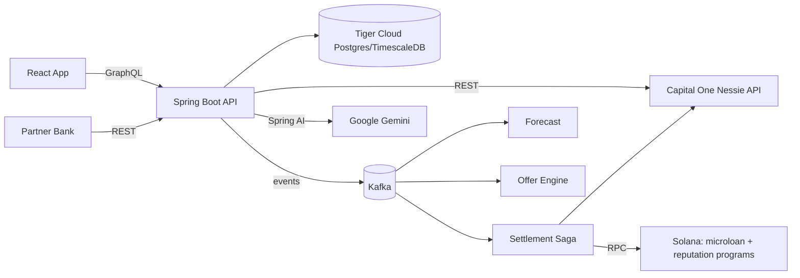

# Project Audit: Proactive Micro-Loans + On-Chain Repayment Reputation

> Single source of context for humans and AI agents. Read this first, then update the **Progress Log** and **Status** sections whenever work is completed.

Last updated: 2026-10-16

---

## 1. Purpose

A hackathon MVP for a banking institution that shifts lending from **reactive** to **proactive**:

1. When a user wants to make a purchase that they can only partially pay, we have an AI agent investigate whether we can give them a micro-loan that they have a high chance of paying off in the next coming months.
2. The AI agent investigates by forecasting the users cash flow in the coming months based on all their banking information (historical data and user-entered recurring expenses and deposits with durations, e.g. "Netflix for 12 months", "car loan for 36 months").
3. If the user accepts the micro-loan, a **Solana powered transaction** instantly transfers the money from the bank to the vendor.
4. **Optional feature:** each on-time repayment updates an on-chain s**Soulbound token**. Higher reputation tiers unlock larger credit limits, and partners can verify the credential via a public endpoint (no PII).

---

## 2. Tech Stack

| Layer | Choice | Notes |
|---|---|---|
| Backend | Java 21, Spring Boot 3.5.x, Maven | Modular monolith (package per domain) |
| API (app) | Spring for GraphQL | Queries, mutations, later subscriptions |
| API (integrations) | REST | Login, webhooks, admin, public credential verify |
| Messaging | **Kafka only** (RabbitMQ rejected) | Event backbone + audit trail; `@RetryableTopic` + DLT for retries |
| Database | PostgreSQL on **Tiger Cloud** (TimescaleDB) | Managed via Tiger CLI + Tiger MCP; hypertables + continuous aggregates |
| Core banking | **Capital One Nessie API** | Source of truth for fiat accounts, balances, transactions |
| AI | **Google GenAI (Gemini)** via Spring AI | Parsing + explanations only, never credit decisions |
| Frontend | React + Vite + TypeScript + Apollo Client | react-router; Recharts planned for forecast chart |
| Blockchain | Solana devnet, Rust/Anchor 0.31.x programs | Java backend calls Solana via solanaj/sava client |
| Local infra | Docker Compose | Kafka (KRaft) + Kafka UI only; DB is Tiger Cloud |

---

## 3. Architecture



### Responsibility split
- **Nessie** owns fiat: balances, deposits, withdrawals, purchases, bills.
- **Postgres** owns derived data (synced transactions, forecasts, offers) and loan state.
- **Solana** owns loan escrow and repayment reputation.

---

## 4. Key Decisions (do not change without updating this file)

1. **Kafka only.** Retries via retry topics + DLT. Idempotent consumers keyed by `eventId`.
2. **Modular monolith.** Packages: `auth`, `user`, `nessie`, `cashflow`, `forecast`, `ai`, `offer`, `loan`, `settlement`, `solana`, `credential`, `notification`, `demo`, `events`.
3. **Deterministic, rule-based underwriting.** AI (Gemini) only parses user input, categorizes merchants, and writes explanations. Required for explainability / fair lending.
4. **Custodial devnet wallets** per user; keys AES-GCM encrypted in Postgres; master key from env.
5. **Mock USDC** SPL mint (6 decimals) controlled by the bank authority.
6. **Auto-repay** via SPL `approve` delegate to the loan PDA at acceptance; the bank authority cranks `repay`.
7. **Simulated clock** (`DemoClock`) drives months; on-chain timing is enforced by the bank authority, not the chain clock.
8. **Credential** = Anchor reputation PDA per wallet + Token-2022 `NonTransferable` token.
9. **Nessie is polled** (no webhooks); dedupe by Nessie `_id`.
10. **Recurring expenses with `durationMonths` live locally**; mirrored to Nessie as bills.
11. **TimescaleDB:** hypertables for `account_transaction`, `balance_snapshot`, `audit_event`; continuous aggregate `monthly_cashflow`. Hypertable unique keys must include the time column. CAGG migrations must run non-transactionally in Flyway.

### Out of scope
Real KYC, real fiat on/off-ramps, mainnet, zero-knowledge proofs, partner-bank integration beyond the public verify endpoint.

---

## 5. Implementation Plan (phases build on each other)

| # | Phase | Depends on | Summary |
|---|---|---|---|
| 0 | Foundations | — | Scaffolding, Kafka compose, Tiger DB + Flyway V1, JWT auth, GraphQL `me`, NessieClient + smoke test, React login shell, Anchor workspace |
| 1 | Nessie ingestion + time-series store | 0 | `DemoSeeder` creates Nessie data ("Alex": shortfall month 4, surplus month 6); `NessieSyncService` polls; hypertables + `monthly_cashflow` CAGG |
| 2 | Forecast engine + dashboard | 1 | `ForecastService` (income patterns + CAGG discretionary avg + recurring expenses, from live Nessie balance); 12-month chart with red/green months |
| 3 | AI layer (Gemini) | 2 | NL expense parsing → user-confirmed drafts; merchant categorization; forecast/offer explanations; cache + fallback; no PII to AI |
| 4 | Kafka backbone | 1 (parallel w/ 2–3) | Event envelope, topics, consumers, audit consumer, idempotency |
| 5 | Offer engine + loan lifecycle | 3, 4 | Shortfall/surplus rules, tier caps, state machine, consent, safeguards using live Nessie balance, `advanceMonth` |
| 6 | Solana programs | parallel w/ 1–5 | Mock USDC, `microloan` + `reputation` programs, Token-2022 SBT, anchor tests, devnet deploy, early Java→Anchor PoC |
| 7 | Settlement saga (Solana + Nessie) | 5, 6 | Disbursement: on-chain disburse → Nessie deposit; Repayment: safeguard → Nessie withdrawal → on-chain repay; compensation on failure |
| 8 | Reputation credential | 7 | Update PDA on repay, mint SBT on first repay, tiers feed offer caps, public REST verify, UI card |
| 9 | Real-time UX + demo polish | 8 | GraphQL subscriptions from Kafka, notifications, demo panel, seeded scenario, demo script |

### Phase details

**Phase 0 — Foundations**
- Tiger CLI: `tiger auth login`, create dev service, `tiger db uri`, `tiger mcp install` (vscode).
- Compose: Kafka KRaft + Kafka UI.
- Backend: Spring Boot, secrets from env/`.env`, Flyway V1 `app_user`, JWT HS256 + `POST /auth/login`, dev-profile demo user seeder, GraphQL `me`, `NessieClient` (customers, accounts), `smoke` profile runner.
- Frontend: Vite React TS, Apollo with auth link, Login + Me pages, Vite proxy.
- Solana: Anchor workspace with stub programs.

**Phase 1 — Nessie ingestion + time-series**
- Hypertables: `account_transaction` (PK `(id, occurred_at)`), `balance_snapshot`, `audit_event`. Regular tables: `recurring_expense`, `loan`, `loan_offer`, `wallet`, `credential`, `forecast_snapshot`.
- Continuous aggregate `monthly_cashflow` (income, spend by category, net per user per month).
- Use `JdbcTemplate` batch inserts for hypertables.

**Phase 2 — Forecast**
- GraphQL: `forecast(months)`, `transactions(range)`, `recurringExpenses`; CRUD mutations for recurring expenses.
- Tests: expenses ending mid-horizon, biweekly income, empty history.

**Phase 3 — AI (Gemini via Spring AI)**
- Structured output for expense parsing; explanations cached per forecast version; deterministic fallback text.

**Phase 4 — Kafka**
- Envelope: `eventId`, `type`, `userId`, `occurredAt`, `payload`, `correlationId`.
- Topics: `transactions.ingested`, `cashflow.changed`, `forecast.updated`, `offer.generated`, `loan.accepted`, `loan.disbursement.requested`, `loan.disbursed`, `loan.repayment.requested`, `loan.repaid`, `loan.defaulted`, `loan.fiat.settled`, `loan.fiat.failed`, `credential.update.requested`, `credential.updated` (+ retry/DLT).

**Phase 5 — Offers + lifecycle**
- Rule: shortfall month *m* with deficit *D*; first surplus month *n* (m+1..m+3) with surplus ≥ D + fee; principal = min(ceil(D), tier cap); flat % fee.
- States: `OFFERED → ACCEPTED → DISBURSING → ACTIVE → REPAYING → REPAID` (+ `LATE → DEFAULTED`).
- Safeguards: min-balance check before auto-repay, grace period, reschedule, early repay.

**Phase 6 — Solana programs**
- `microloan`: `init_pool`, `create_loan`, `disburse`, `repay`, `mark_default`.
- `reputation`: `init_reputation`, `record_repayment`, `record_default` (bank-authority only).
- Token-2022 NonTransferable + metadata SBT.

**Phase 7 — Settlement**
- `SolanaClient` (Anchor 8-byte discriminator + Borsh encoding), `WalletService`, `DisbursementSaga`, `RepaymentSaga`.
- Store Solana tx signature and Nessie transaction id on each loan; UI shows Explorer links.

**Phase 8 — Credential**
- Tiers: Tier 0 $200 → Tier 1 $500 (2 on-time) → Tier 2 $1,000 (5 on-time).
- `GET /api/public/credentials/{wallet}` reads on-chain PDA, returns no PII.

**Phase 9 — Demo polish**
- Subscriptions: `loanUpdated`, `offerCreated`, `credentialUpdated`, `balanceUpdated`.
- Demo script: onboard → forecast dip → offer + AI explanation → accept → disbursement (Solana + Nessie) → advance month → auto-repay → SBT minted / tier up.

---

## 6. Repository Layout

```
sh_bean/
├── audit.md                  # this file
├── .env.example              # copy to .env (git-ignored)
├── .gitignore
├── infra/docker-compose.yml  # Kafka (9092) + Kafka UI (8081)
├── backend/                  # Spring Boot (package com.shbean)
│   ├── pom.xml
│   └── src/
│       ├── main/java/com/shbean/
│       │   ├── ShBeanApplication.java
│       │   ├── auth/         # SecurityConfig, JwtProperties, TokenService, AuthController, AppUserDetailsService
│       │   ├── user/         # AppUser, AppUserRepository, MeController, DemoProperties, DemoUserSeeder
│       │   └── nessie/       # NessieClient, NessieModels, NessieProperties, NessieException, NessieSmokeRunner
│       ├── main/resources/
│       │   ├── application.yml, application-dev.yml
│       │   ├── db/migration/V1__app_user.sql
│       │   └── graphql/schema.graphqls
│       └── test/java/com/shbean/
│           ├── auth/AuthFlowIntegrationTest.java   # Testcontainers (timescale/timescaledb)
│           └── nessie/NessieClientTest.java        # MockRestServiceServer
├── frontend/                 # React + Vite + Apollo
│   ├── package.json, tsconfig.json, vite.config.ts, index.html
│   └── src/ (main.tsx, apollo.ts, auth.ts, index.css, pages/Login.tsx, pages/Me.tsx)
└── solana/                   # Anchor workspace
    ├── Anchor.toml, Cargo.toml
    └── programs/{microloan,reputation}/src/lib.rs   # stubs
```

---

## 7. Configuration & Secrets

All secrets come from environment variables or a root `.env` (imported by Spring via `spring.config.import`). Never commit `.env`.

| Variable | Purpose |
|---|---|
| `DB_URL` | JDBC URL, e.g. `jdbc:postgresql://<host>:<port>/tsdb?sslmode=require` (convert from `tiger db uri`) |
| `DB_USER`, `DB_PASSWORD` | Tiger Cloud credentials |
| `KAFKA_BOOTSTRAP` | Default `localhost:9092` |
| `NESSIE_BASE_URL`, `NESSIE_API_KEY` | Nessie API |
| `GEMINI_API_KEY` | Google GenAI (Phase 3) |
| `JWT_SECRET` | ≥ 32 bytes (`openssl rand -base64 48`); app refuses to start otherwise |
| `DEMO_USER_EMAIL`, `DEMO_USER_PASSWORD` | Seeded in `dev` profile |

Spring profiles: `dev` (GraphiQL + demo user seeding), `smoke` (Nessie round-trip on startup).

---

## 8. Security Conventions

- Stateless JWT (HS256) on all routes except `POST /auth/login`, `/actuator/health`, `/graphiql/**`, `/error`.
- Passwords hashed with BCrypt; generic "Invalid credentials" on any login failure.
- **Nessie API key travels as a query param.** `NessieClient` wraps all calls and throws `NessieException` **without chaining the cause** (RestClient messages contain the full URI). Never log Nessie request URLs. Tests assert the key never appears in exceptions.
- GraphQL exposes a `UserView` record, never the entity (no password hash leakage).
- Frontend stores the token in `sessionStorage`; 401 → clear token and redirect to login.
- AI receives only aggregated figures — no Nessie IDs, account numbers, or names.
- Public credential endpoint must return no PII.
- Wallet private keys encrypted at rest; never logged.

---

## 9. Status

| Phase | Status |
|---|---|
| 0 Foundations | **Code written, not yet compiled/run/verified** |
| 1 – 9 | Not started |

### Phase 0 verification checklist
- [ ] User: `tiger auth login`, create service, `tiger mcp install`; fill `.env`
- [ ] User: obtain Nessie and Gemini API keys
- [ ] `docker compose -f infra/docker-compose.yml up -d` → Kafka healthy, Kafka UI at http://localhost:8081
- [ ] `cd backend && mvn verify` (unit + Testcontainers tests; needs Docker)
- [ ] `mvn spring-boot:run -Dspring-boot.run.profiles=dev` → Flyway V1 applied on Tiger, demo user seeded
- [ ] `mvn spring-boot:run -Dspring-boot.run.profiles=smoke` → Nessie customer + account created and read back; key not in logs
- [ ] `cd frontend && npm install && npm run dev` → login at http://localhost:5173, Me page shows email
- [ ] `cd solana && anchor build && anchor keys sync` → real program IDs replace placeholders

---

## 10. Progress Log

| Date | Change |
|---|---|
| 2026-10-16 | Idea selected (proactive micro-loans + hybrid reputation credential). Stack decided: Spring Boot, GraphQL + REST, Kafka (RabbitMQ rejected). |
| 2026-10-16 | Plan v2: switched MySQL → Postgres/TimescaleDB on Tiger Cloud; added Capital One Nessie as core banking. |
| 2026-10-16 | Phase 0 scaffolding written in `sh_bean/` (backend, frontend, infra, solana stubs). Not yet built or run. |

---

## 11. Known Issues / Open Questions

- **Nessie base URL defaults to `http://`** (cleartext API key). Switch `NESSIE_BASE_URL` to `https://` if supported.
- Nessie endpoint shapes are based on the standard Nessie API (`/customers`, `/customers/{id}/accounts`, `/accounts/{id}`, `?key=`); verify with the smoke profile.
- Anchor programs share a placeholder program ID until `anchor keys sync`.
- Dependency versions were pinned without network verification (Spring Boot 3.5.6, Anchor 0.31.1, Vite 6, React 19, Apollo Client 3.13); bump if newer stable versions are desired.
- Choose solanaj vs sava for the Java Solana client (PoC planned in Phase 6).
- Nessie rate limits / shared sandbox: sync on demand, cache, use WireMock recordings in CI.
- The original workspace folder `sh_planning` was removed; the project lives in `sh_bean`.

---

## 12. Instructions for Agents

1. Read sections 1, 4, 5, and 9 before writing code.
2. Work phase by phase; don't start a phase whose dependencies aren't verified.
3. Respect the Key Decisions and Security Conventions; record any deviation here.
4. After completing work: update **Status**, tick checklist items, and append to the **Progress Log**.
5. New Flyway migrations: increment version (`V2__...`); never edit applied migrations.
6. New Kafka topics: declare as `NewTopic` beans (auto-create is disabled in compose).
